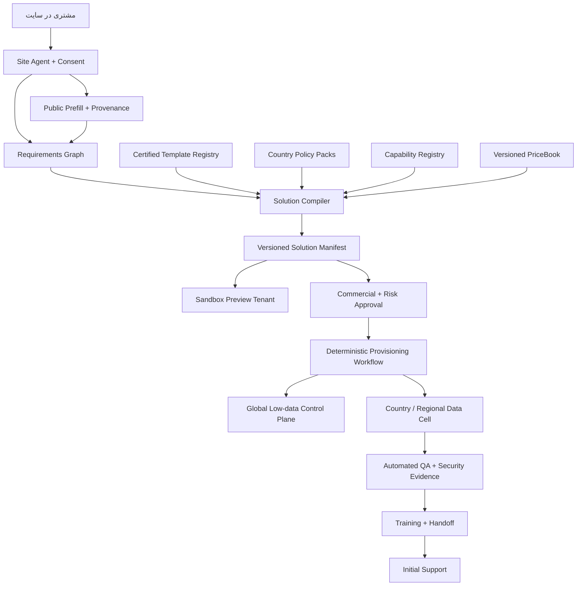

# نقشه راهبردی کارخانه تحویل یک‌روزه ManovaFlow

**تاریخ:** ۴ سپتامبر ۲۰۲۶  
**وضعیت:** تعریف محصول توسط مالک تأیید شده؛ قابلیت فنی و تقاضای بازار هنوز باید اثبات شوند  
**مخاطب:** مالک محصول، معمار ارشد و تیم محصول/عملیات  
**نوع سند:** راهبرد محصول و معماری؛ بدون کد، خرید، استقرار یا ارتباط بیرونی  
**مبنای شواهد:** [گزارش تحقیق بازار و معماری ManovaFlow](../research/2026-09-04-manovaflow-market-architecture-research.md)

## نسبت این سند با طرح قبلی

این سند، فایل «نخستین پیشنهاد قابل‌فروش به کلینیک‌ها» را حذف یا بازنویسی نمی‌کند. طرح قبلی یک مسیر خدمت‌محور و دستی‌تر برای Discovery است. تعریف تأییدشده جدید، مدل اصلی محصول آینده را اصلاح می‌کند: **مالک شخصاً اطلاعات مشتری را جمع نمی‌کند؛ عامل داخل سایت کشف، پیش‌پرکردن، تأیید، پیش‌نمایش، ساخت و تحویل استاندارد را هدایت می‌کند.**

طرح قبلی فقط می‌تواند گزینه اضطراری یادگیری دستی باشد؛ این سند منبع راهبردی مدل کارخانه خودکار است.

---

## ۱. تعریف یک‌خطی محصول

> **ManovaFlow کارخانه خودکار داخل سایت است که با اجازه مشتری کسب‌وکار را می‌شناسد، نیازها و قواعدش را تأیید می‌گیرد، همان روز یک پیش‌نمایش تعاملی می‌سازد و پس از تأییدهای تجاری و حساس، tenant استانداردِ جدا، پیکربندی‌شده و آزموده را تا روز کاری بعد تحویل می‌دهد.**

شعار هدف:

> **نمایش امروز، تحویل نسخه استاندارد فردا.**

### وضعیت حقیقت شعار

**TARGET / UNPROVEN:** این شعار هدف محصول است و اکنون ادعای قابل انتشار نیست. فقط پس از تحویل موفق حداقل ۱۰ سفارش استاندارد آزمایشی متوالی، قبولی معیارهای فنی و رسیدن حداقل ۹ مورد از ۱۰ مورد به زمان تعهدشده می‌توان آن را به ادعای بازاری تبدیل کرد.

### محصول چیست؟

- گفت‌وگوی تعاملی داخل سایت؛
- موتور کشف نیاز ساختاریافته؛
- prefill مبتنی بر منابع عمومی مجاز و قابل استناد؛
- کارخانه template/configuration؛
- preview sandbox با داده مصنوعی؛
- موتور قیمت و entitlement نسخه‌دار؛
- workflow خودکار provisioning، configuration، QA، آموزش و تحویل؛
- هسته چندمستاجری کنترل‌شده و حسابرسی‌پذیر؛
- Growth & Marketing Agent محدود و مرحله‌ای برای تحقیق، محتوا، outreach مجاز و تحلیل قیف.

### محصول چیست نیست؟

- عامل آزاد برای ساخت دلخواه هر نرم‌افزار؛
- تولیدکننده کد اختصاصی در مسیر استاندارد؛
- شرکت کاملاً خودران یا جایگزین همه کارکنان؛
- ابزار جمع‌آوری پنهانی اطلاعات عمومی یا شخصی؛
- مجوز خودکار پردازش داده حساس؛
- اتصال خودسرانه به CRM، پیام، تبلیغ، پرداخت یا تلفن؛
- تضمین یک‌روزه برای سفارش سفارشی، کشور پشتیبانی‌نشده یا حوزه تنظیم‌شده.

### تز راهبردی

**OWNER DECISION / APPROVED:** تجربه باید از گفت‌وگو تا tenant تحویلی، تا حد ممکن توسط عامل‌ها انجام شود و انسان فقط در قیمت/قرارداد/پرداخت، داده حساس، اتصال واقعی و استثنا gate داشته باشد.

**INFERENCE:** سرعت یک‌روزه فقط با «template تأییدشده + configuration محدود + provisioning قطعی» ممکن است. اگر عامل برای هر مشتری کد تازه بنویسد، زمان، امنیت و تکرارپذیری از کنترل خارج می‌شوند.

---

## ۲. قرارداد شواهد و حقیقت‌سنجی

برچسب‌ها:

- **FACT / PROVEN:** منبع رسمی یا آزمون قابل بازسازی آن را تأیید کرده است.
- **OWNER DECISION / APPROVED:** جهت محصولی تصویب‌شده است؛ واقعیت بازار یا قابلیت موجود نیست.
- **INFERENCE / HYPOTHESIS:** پیشنهاد این سند است و باید با مشتری یا آزمون فنی تأیید شود.
- **TARGET / UNPROVEN:** نتیجه‌ای است که محصول باید بعداً ثابت کند.
- **UNKNOWN / NOT_CAPTURED:** شواهد کافی وجود ندارد.

هیچ خروجی مدل دیگر در این سند منبع واقعی تلقی نشده است. هر نظر مدل فقط با برچسب `HYPOTHESIS` قابل ثبت است و برای ادعای فنی، حقوقی یا بازار به منبع اولیه یا آزمون قابل بازسازی نیاز دارد.

| ادعای پراثر | وضعیت | قاعده استفاده |
|---|---|---|
| ManovaFlow اکنون نسخه استاندارد را یک‌روزه تحویل می‌دهد | **TARGET / UNPROVEN** | تا عبور proof gate گفته نشود |
| عامل می‌تواند tenant امن و جدا بسازد | **TARGET / UNPROVEN** | فقط تست منفی cross-tenant و evidence آن را ثابت می‌کند |
| اطلاعات عمومی را می‌توان آزادانه برداشت و استفاده کرد | **نادرست به‌عنوان قاعده عمومی** | اجازه، منبع مجاز، شرایط استفاده، purpose و provenance لازم‌اند |
| QA خودکار مساوی امنیت کامل است | **نادرست** | threat model، review و عملیات امنیتی لازم‌اند |
| multi-agent بودن خودبه‌خود ارزش بازار است | **UNKNOWN / NOT_CAPTURED** | outcome و زمان تحویل معیار فروش‌اند، نه تعداد عامل |
| قیمت پیشنهادی مدل، قیمت بازار است | **نادرست** | عامل فقط PriceBook مصوب را می‌خواند؛ قیمت نهایی gate انسانی دارد |
| preview ثابت می‌کند دکمه‌های tenant کار می‌کنند | **نادرست بدون آزمون** | preview و tenant باید از یک manifest باشند و tenant جداگانه E2E شود |
| تقاضای کافی برای این مدل وجود دارد | **UNKNOWN / NOT_CAPTURED** | با ۲۰ گفت‌وگو، پنج design partner و سه سفارش پولی آزموده شود |

---

## ۳. سفر مشتری گام‌به‌گام

مشتری نباید فرم بلند پر کند و منتظر تماس فروش بماند. عامل سایت گفتگو را پیش می‌برد، هر داده را با وضعیت `prefilled / customer-confirmed / human-approved` نشان می‌دهد و در هر مرحله خروجی قابل مشاهده می‌سازد.

| مرحله | تجربه مشتری | خروجی سیستمی | gate |
|---:|---|---|---|
| ۰. ورود | معرفی روشن عامل و انتخاب زبان | `ConversationSession` و locale | disclosure AI |
| ۱. هدف | انتخاب مسئله و outcome | `IntentDraft` | بدون gate داخلی |
| ۲. اجازه prefill | انتخاب URL و منابع مجاز | `PrefillConsent` زمان‌دار | تأیید مشتری |
| ۳. شناخت عمومی | پیشنهاد نام، خدمات، ساعات و شعب با منبع | `BusinessProfileDraft` | تأیید هر فیلد |
| ۴. کشف | سؤال درباره نقش، حجم، SLA، ارجاع و ممنوعیت | `RequirementsGraph` | حساسیت مسیر جدا دارد |
| ۵. تأیید | نمایش diff نهایی و اصلاح | `ConfirmedRequirementsSnapshot` | تأیید مشتری |
| ۶. طراحی | انتخاب template و capability | `SolutionManifestDraft` | schema/policy validation |
| ۷. پیش‌نمایش امروز | sandbox تعاملی با داده مصنوعی | `PreviewTenant` | بدون side effect |
| ۸. سناریوی زنده | اجرای درخواست مصنوعی تا outcome | `PreviewRunEvidence` | sandbox only |
| ۹. بسته/قیمت | نمایش اقلام، محدودیت و قیمت مصوب | `QuoteDraft` | قیمت/تخفیف gate انسانی |
| ۱۰. قرارداد/پرداخت | بررسی تجاری و هویتی | `CommercialApprovalToken` | **gate انسانی** |
| ۱۱. حساسیت/اتصال | طبقه‌بندی داده، کشور و connector | `RiskDecision` | **gate انسانی** |
| ۱۲. freeze | تأیید دامنه نهایی | `OrderManifest` امضاشده | تغییر بعدی Change Request |
| ۱۳. provisioning | ساخت tenant و منابع | `ProvisioningRun` idempotent | token معتبر |
| ۱۴. configuration | اعمال نقش، خدمت، routing و workflow | `ConfigurationRelease` | policy gates |
| ۱۵. QA | تست manifest، نقش، isolation و UI | `EvidencePack` | شکست = عدم تحویل |
| ۱۶. آموزش/تحویل | دعوت ادمین و تور نقش‌محور | `HandoffAcceptance` | پذیرش مشتری |
| ۱۷. پشتیبانی | حل یا triage مسئله اولیه | `SupportCase` | استثنا/امنیت به انسان |

وضعیت‌های سفارش:

`DISCOVERING → CONFIRMED → PREVIEW_READY → COMMERCIAL_REVIEW → APPROVED → PROVISIONING → CONFIGURING → QA_BLOCKED | READY_FOR_HANDOFF → ACCEPTED → INITIAL_SUPPORT`

هیچ عامل با متن آزاد نمی‌تواند `COMMERCIAL_REVIEW` یا `QA_BLOCKED` را دور بزند.

### آغاز ساعت یک‌روزه

`T0` فقط وقتی ثبت می‌شود که Definition of Ready کامل باشد:

- سفارش داخل Standard است؛
- اطلاعات و prefill تأیید شده‌اند؛
- قیمت، قرارداد و پرداخت gate شده‌اند؛
- داده حساس یا اتصال واقعی وجود ندارد؛
- کشور، زبان و template پشتیبانی می‌شوند؛
- Order Manifest freeze شده است.

هدف: `T0` پیش از ساعت ۱۲ محلی → تحویل تا ساعت ۱۷ روز کاری بعد؛ `T0` بعد از ۱۲ → تحویل تا ساعت ۱۷ دومین روز کاری. تعطیلات و timezone در Quote نمایش داده می‌شوند.

---

## ۴. نقش عامل‌ها و مرز اختیار

تعداد عامل‌ها تعهد بازاری نیست. نقش‌ها قرارداد توانمندی‌اند و در اجرا می‌توانند ادغام شوند.

| نقش | اختیار مجاز | خروجی | اختیار ممنوع / gate |
|---|---|---|---|
| Site Concierge | disclosure، زبان، هدف و راهنمایی | session و intent | پنهان‌کردن AI یا فشار فروش |
| Public Prefill Agent | خواندن allowlist با اجازه و استخراج عمومی | draft با citation/confidence | commit خودکار یا جمع‌آوری شخصی |
| Discovery Agent | پرسش تطبیقی و requirements graph | نیاز، قاعده و ابهام | درخواست secret یا حساس بدون gate |
| Solution Composer | انتخاب template/capability | solution manifest و diff | تولید/اجرای کد آزاد |
| Preview Builder | ساخت sandbox از همان manifest | preview و evidence | داده یا connector واقعی |
| Commercial Advisor | انتخاب SKU از PriceBook | quote draft | اختراع قیمت، تخفیف یا قرارداد |
| Provisioning Agent | اجرای workflow مصوب | tenant و resource refs | اجرا بدون token یا تغییر region |
| Configuration Agent | اعمال config تأییدشده | configuration release | تغییر خارج manifest یا secret |
| QA/Security Agent | اجرای suite و block release | pass/fail و defect | نادیده‌گرفتن failure یا ادعای compliance |
| Training Agent | تور، تمرین synthetic و پذیرش | handoff record | آموزش با داده واقعی |
| Support Agent | پاسخ مصوب، triage و escalation | support case | تغییر قیمت، policy یا دسترسی |
| Growth & Marketing Agent | تحقیق عمومی مجاز، fit score، draft محتوا/پیام، قیف و آزمایش | account/content/outreach drafts و analytics | scrape شخصی، spam، جعل، خرج یا قرارداد بدون انسان |

خانواده‌های رسمی محصول:

- **Sales Agent:** ترکیب Site Concierge، Discovery و Commercial Advisor برای کشف، پیش‌نمایش، بسته و quote؛
- **Marketing Agent:** Growth & Marketing برای تحقیق، محتوا، outreach کنترل‌شده و قیف؛
- **Onboarding Agent:** Provisioning، Configuration و Training برای ساخت و تحویل؛
- **Quality Control Agent:** QA/Security برای blockکردن release فاقد شواهد.

### Orchestrator عامل نیست

Orchestrator باید workflow قطعی مالک state، timeout، retry، budget، approval، idempotency و compensation باشد. عامل فقط پیشنهاد ساختاریافته می‌دهد. Temporal، workflowهای durable و ادامه پس از خرابی را مستند می‌کند؛ انتخاب فناوری نهایی در اجرای معماری تثبیت می‌شود. [Temporal](https://docs.temporal.io/) و [Temporal Workflows](https://docs.temporal.io/workflows)

### دروازه اقدام

همه side effectها فقط از Action Gateway عبور می‌کنند:

- schema ورودی/خروجی؛
- tenant و actor قطعی؛
- scope حداقل؛
- idempotency key؛
- policy version؛
- approval token زمان‌دار؛
- dry-run/diff؛
- timeout/retry/compensation؛
- audit و kill switch.

این مرز با خطرهای prompt injection، افشای داده، improper output handling و excessive agency هم‌راستاست. [OWASP Top 10 for LLM and GenAI](https://genai.owasp.org/initiatives/top-10-for-llm-and-genai/) Guardrail مدل مفید است اما جای policy engine مستقل را نمی‌گیرد. [OpenAI Agents SDK Guardrails](https://openai.github.io/openai-agents-python/guardrails/)

### gateهای انسانی

| موضوع | عامل | انسان |
|---|---|---|
| قیمت | SKU و PriceBook را پیشنهاد می‌دهد | قیمت نهایی، تخفیف، مالیات و اعتبار |
| قرارداد | scope/manifest را خلاصه می‌کند | تعهد، DPA، SLA و امضا |
| پرداخت | invoice state را می‌خواند | وصول، بازپرداخت و اختلاف |
| داده حساس | نوع و خطر را علامت می‌کند | lawful basis و اجازه پردازش |
| اتصال واقعی | scope/permission را نشان می‌دهد | ادمین مشتری مجوز می‌دهد؛ ManovaFlow فعال‌سازی را gate می‌کند |
| استثنا | Change Request و اثر را می‌سازد | مالک/معمار قبول یا رد می‌کند |
| خرج تبلیغ | بودجه/سناریو را پیش‌نویس می‌کند | مبلغ، کانال، مخاطب و launch را تأیید می‌کند |
| رخداد امنیتی | تشخیص و مهار مجاز | incident commander تصمیم پراثر می‌گیرد |

بعد از gateهای معتبر، مسیر استاندارد بدون دخالت دستی روزمره مالک ادامه می‌یابد. حذف کار دستی به معنی حذف مسئولیت، audit یا kill switch نیست.

---

## ۵. تجربه واو در روز اول

### Business Twin Preview

مشتری URL رسمی را می‌دهد و اجازه prefill می‌دهد. عامل ظرف چند دقیقه:

1. نام، خدمات، ساعات، شعب و تماس عمومی را با منبع/زمان نشان می‌دهد؛
2. فیلد نامطمئن یا متناقض را برجسته می‌کند؛
3. تأیید یا اصلاح می‌گیرد؛
4. نقش، ساعات، ارجاع و موارد ممنوع را تکمیل می‌کند؛
5. نقشه `Request-to-Resolution` را زنده می‌سازد؛
6. preview tenant با داده مصنوعی تولید می‌کند؛
7. یک درخواست آزمایشی را تا outcome عبور می‌دهد؛
8. برای هر تصمیم، قاعده و actor را نشان می‌دهد؛
9. بسته استاندارد، محدودیت و قیمت PriceBook را نمایش می‌دهد.

لحظه واو، اسلاید یا متن تولیدشده نیست؛ مشتری نسخه قابل تعامل کسب‌وکار خودش را می‌بیند، در حالی که هیچ داده‌ای بدون تأیید قطعی و هیچ side effect واقعی اجرا نشده است.

در همه صفحات باید این وضعیت‌ها دیده شوند:

- `PREVIEW / SYNTHETIC DATA`؛
- `NO LIVE INTEGRATION`؛
- `NO EXTERNAL ACTIONS`؛
- قابلیت غیرفعال همراه دلیل و gate؛
- نسخه manifest و تفاوت دقیق preview با Standard.

**INFERENCE / HYPOTHESIS:** median زمان از رضایت prefill تا preview باید کمتر از ۱۵ دقیقه، تعداد سؤال اجباری کمتر از ۱۲ و نرخ تکمیل گفت‌وگو حداقل ۴۰٪ باشد. این اعداد آستانه آزمایشی‌اند، نه benchmark بازار.

---

## ۶. دامنه دقیق تحویل یک‌روزه

### Standard One-Day Tenant

| جزء | سقف استاندارد |
|---|---|
| tenant | یک tenant در یک data cell پشتیبانی‌شده |
| شعبه | یک شعبه |
| locale | یک زبان و یک timezone |
| کانال | یک صفحه ورودی web میزبانی‌شده؛ بدون نصب روی سایت مشتری |
| workflow | یک `Request-to-Resolution` از template تأییدشده |
| وضعیت‌ها | حداکثر ۷ وضعیت از registry استاندارد |
| نقش‌ها | Owner، Operator و Viewer؛ حداکثر ۵ دعوت کاربر |
| خدمات | حداکثر ۲۰ خدمت تأییدشده |
| ساعات | ساعات هفتگی + حداکثر ۱۰ استثنای تعطیلی |
| routing | حداکثر ۱۰ قاعده declarative |
| escalation | حداکثر ۵ مسیر ارجاع |
| دانش | حداکثر ۳۰ مدخل کوتاه از منابع عمومی تأییدشده |
| داشبورد | ورودی، وضعیت، owner، زمان پاسخ و outcome |
| اقدام‌ها | ایجاد/ویرایش درخواست، تخصیص، تغییر وضعیت، یادداشت داخلی، ارجاع و export |
| Growth | فقط G0: تحقیق عمومی، fit score و پیش‌نویس محتوا/پیام؛ بدون ارسال بیرونی |
| داده شروع | فقط seed مصنوعی؛ داده واقعی مشتری وارد نمی‌شود |
| آموزش | تور داخل محصول + جلسه گروهی ۳۰ دقیقه‌ای |
| پشتیبانی | هفت روز کاری برای config/usage؛ بدون SLA سازمانی |

### بسته تحویل

- URL امن tenant؛
- حساب Admin با دعوت امن؛
- manifest و نسخه template؛
- تنظیمات تأییدشده؛
- workflow فعال در محدوده داخلی؛
- داده demo قابل پاک‌سازی؛
- evidence pack قبولی QA؛
- راهنمای نقش‌محور و checklist پذیرش؛
- export تنظیمات و داده مجاز؛
- کانال support اولیه.

### خارج از Standard

- custom code یا schema؛
- کشور، زبان یا vertical بدون pack تأییدشده؛
- CRM، تقویم، پیام‌رسان، تلفن، پرداخت یا EHR واقعی؛
- custom domain یا embed روی سایت مشتری؛
- data migration؛
- SSO/SCIM و SLA اختصاصی؛
- صوت یا outbound؛
- داده سلامت، مالی، هویتی حساس یا biometric؛
- تصمیم بالینی، اعتبار، استخدام یا پرداخت؛
- بیش از یک workflow، branch یا locale؛
- UI خارج design token و گزینه‌های template.

هر مورد خارج دامنه، سفارش را به `CUSTOM_REVIEW` می‌برد. اگر تست حیاتی شکست بخورد، tenant تحویل نمی‌شود؛ وضعیت `QA_BLOCKED` و دلیل آن به مشتری نمایش داده می‌شود. حفظ شعار مجوز عبور از QA نیست.

### تحویل در برابر Go-Live

تحویل یک‌روزه یعنی محیط خصوصی مشتری با state سروری، قابلیت‌های Standard، داده synthetic و Evidence Pack آماده پذیرش است. این وعده به معنی انتشار عمومی intake یا ورود خودکار داده واقعی نیست. `GO_LIVE` فقط پس از تأیید ادمین مشتری، privacy notice، retention، country policy و نوع داده مجاز فعال می‌شود؛ اتصال بیرونی همچنان gate جدا دارد.

---

## ۷. اطلاعات حداقلی و prefill/تأیید

| خانواده | فیلد لازم | منبع مجاز | تأیید |
|---|---|---|---|
| هویت | نام نمایشی، کشور، timezone، زبان | سایت رسمی/مشتری | field-by-field |
| شعبه | نشانی عمومی و منطقه خدمت | سایت رسمی/مشتری | مشتری |
| خدمات | نام، شرح کوتاه، فعال/غیرفعال | صفحه رسمی | مشتری |
| ساعات | روز، بازه و تعطیلی | صفحه تماس/مشتری | مشتری |
| نقش‌ها | عنوان و مسئولیت؛ بدون اطلاعات شخصی | گفتگو | مشتری |
| کانال‌ها | کانال‌های موجود؛ بدون credential | گفتگو/سایت | مشتری |
| درخواست‌ها | taxonomy حداکثر ۱۰ نوع | گفتگو/template | مشتری |
| routing | شرط، مقصد نقش و ساعات | گفتگو | مشتری |
| escalation | محرک، مقصد انسانی و مهلت | گفتگو | مشتری |
| SLA داخلی | زمان پاسخ/پیگیری هدف | گفتگو | مشتری |
| ممنوعیت | موضوع حساس و اقدام ممنوع | گفتگو/country pack | مشتری + policy |
| ادمین | نام و ایمیل کاری فرد مجاز | ورود مستقیم | verification |

### پروتکل prefill

1. disclosure و purpose توضیح داده می‌شود؛
2. مشتری دامنه و URLهای allowlist را انتخاب می‌کند؛
3. سیستم robots، امکان فنی و policy داخلی را کنترل می‌کند؛
4. فقط سایت رسمی و رجیستری عمومی مجاز خوانده می‌شوند؛
5. URL، زمان، excerpt کوتاه، confidence و extractor version ثبت می‌شوند؛
6. تعارض‌ها کنار هم نمایش داده می‌شوند؛
7. هیچ فیلدی بدون تأیید از `draft` به `confirmed` نمی‌رود؛
8. مشتری می‌تواند منبع یا فیلد را حذف کند؛
9. snapshot تأییدشده hash/version می‌گیرد؛
10. داده خام اضافی طبق retention کوتاه حذف می‌شود.

### منابع ممنوع

- حساب شخصی کارکنان؛
- review مشتریان برای استخراج هویت یا پروفایل؛
- data broker، پایگاه نشت‌کرده یا scrape غیرمجاز؛
- صفحه نیازمند login/paywall؛
- داده حساس قابل استنتاج؛
- محتوای بدون حق استفاده یا دارای منع قراردادی؛
- فهرست تماس شخصی.

«عمومی» مساوی «آزاد برای هر استفاده» نیست. اجازه مشتری نیز حقوق اشخاص ثالث یا شرایط منبع را حذف نمی‌کند.

### ابهام و تعارض

- confidence پایین → سؤال مستقیم؛
- دو منبع متناقض → نمایش هر دو و انتخاب مشتری؛
- داده قدیمی → `stale`؛
- فیلد حیاتی تأییدنشده → توقف preview نهایی؛
- داده حساس → `SensitiveDataReview`؛
- پاسخ نامطمئن → ثبت به‌عنوان assumption و خروج از automation.

---

## ۸. معماری محصول کارخانه

**INFERENCE — توصیه:** یک modular monolith مبتنی بر TypeScript برای control/product plane، PostgreSQL برای state، durable workflow برای فرایندهای طولانی و data cellهای جدا برای tenantها. microservice زودهنگام رد می‌شود؛ مرز ماژول و outbox/event از ابتدا حفظ می‌شود.

### ۸.۱ Conversation and Consent

session، locale، disclosure، purpose، consent نسخه‌دار، resume امن، redaction و انتقال حساسیت به انسان.

### ۸.۲ Requirements Ledger

موجودیت‌های `Requirement`, `Rule`, `Role`, `Service`, `Schedule`, `Escalation`, `Constraint` با منشأ، confidence، وضعیت، diff و hash. هیچ chain-of-thought ذخیره نمی‌شود.

### ۸.۳ Certified Template Registry

هر template شامل domain schema، workflow، فرم/نما، role matrix، policy defaults، knowledge schema، capability flags، acceptance suite، migration path، country compatibility و SKU mapping است. Template بدون suite قبولی و owner به `CERTIFIED` نمی‌رسد.

### ۸.۴ Solution Compiler

عامل کد آزاد تولید نمی‌کند. Compiler، template تأییدشده را با configuration مشتری merge و `SolutionManifest` می‌سازد. هر override باید در schema مجاز باشد. manifest شامل resources، entitlement، roles، workflow، policy، UI tokens، knowledge references و test plan است.

### ۸.۵ Preview Sandbox

- از همان manifest نسخه تحویلی ساخته می‌شود؛
- namespace و داده مصنوعی دارد؛
- connectorها fake و side effect خاموش‌اند؛
- expiry/reset دارد؛
- رفتارهای Standard واقعاً در sandbox اجرا می‌شوند؛
- تفاوت production آشکار است.

### ۸.۶ PriceBook and Entitlements

- کشور/ارز/مالیات، setup، subscription، usage، support و expiry نسخه‌دار؛
- mapping قطعی capability به SKU؛
- quote فقط از PriceBook فعال؛
- discount و custom term خارج اختیار عامل؛
- quote متصل به manifest hash.

مدل تجاری آغازین: setup fee + subscription + usage شفاف؛ revenue share رد می‌شود. بازه‌های گزارش تحقیق—setup آزمایشی ۱۰۰۰ تا ۵۰۰۰ دلار و base حدود ۲۴۹ تا ۶۹۹ دلار در ماه—**فرضیه‌اند، نه قیمت بازار** و پیش از PriceBook باید توسط مالک تصویب شوند.

### ۸.۷ Provisioning Orchestrator

گام‌های idempotent و قابل resume، resource naming قطعی، cell assignment، secret reference، rollback/compensation، timeout/retry محدود، وضعیت قابل مشاهده و اتصال هر run به manifest/approval token.

### ۸.۸ Tenant Runtime

Standard در pool یک data cell کشور با `tenant_id` و RLS؛ مشتری حساس/Enterprise در schema، database یا cell اختصاصی. این bridge با الگوهای رسمی silo/pool/bridge در AWS هم‌راستاست. [AWS SaaS Lens](https://docs.aws.amazon.com/wellarchitected/latest/saas-lens/silo-pool-and-bridge-models.html)

PostgreSQL با RLS فعال و نبود policy قابل اعمال، default-deny است؛ ولی cache، queue، object storage، log و backup نیز باید tenant-aware باشند. [PostgreSQL 18 CREATE POLICY](https://www.postgresql.org/docs/18/sql-createpolicy.html)

### ۸.۹ QA and Evidence

manifest/schema validation، policy/entitlement validation، migration dry-run، unit/contract/E2E، RBAC allow/deny، cross-tenant negative، idempotency، accessibility/browser smoke، secret/PII scan، dependency/config security scan، restore proof و evidence pack امضاشده.

### ۸.۱۰ Handoff and Support

تور Owner/Operator/Viewer، تمرین synthetic، checklist محدودیت، پذیرش manifest، هفت روز support و ارجاع امنیت/حساسیت/integration/policy به انسان.

### ۸.۱۱ هسته مشترک

هسته باید مستقل از صنعت این قراردادها را مالک باشد:

| ماژول هسته | مسئولیت مشترک |
|---|---|
| Tenant & Identity | سازمان، شعبه، کاربر، role، session و entitlement |
| Business Profile | هویت، خدمات، ساعات، locale و منابع تأییدشده |
| Conversation & Consent | گفتگو، disclosure، purpose، consent و suppression |
| Requirements & Provenance | نیاز، قاعده، confidence، source، diff و approval |
| Case & Workflow | درخواست، وضعیت، owner، SLA، task، retry و outcome |
| Policy & Approval | R0–R4، gate، budget، exception و kill switch |
| Knowledge | منبع، نسخه، citation، scope و expiry |
| Action & Integration | action contract، OAuth reference، idempotency و reconciliation |
| Usage & Commercial | PriceBook، quote، meter، ledger و invoice state |
| Audit & Data Lifecycle | audit، retention، export/delete، incident و evidence |
| Evaluation & Operations | QA، eval، observability، release و support |
| Growth | account، consent، campaign policy، funnel و experiment |

هسته نباید اصطلاح، schema، workflow یا قانون یک صنعت را hard-code کند.

### ۸.۱۲ بسته‌های صنعتی

هر `Industry Pack` یک بسته declarative، نسخه‌دار و قابل certification است:

- موجودیت و taxonomy تخصصی؛
- intentها و outcomeهای معتبر؛
- workflowها، SLA و escalation؛
- role mapping و نقاط approval؛
- فرم، view، واژگان و محتوای راهنما؛
- connector definition بدون credential؛
- KPI و evaluation dataset؛
- policy، retention و ممنوعیت‌های حوزه؛
- fixture کاملاً synthetic برای preview؛
- migration و acceptance suite.

فرمول ساخت:

`Shared Core + Certified Industry Pack + Country Policy Pack + Confirmed Tenant Overlay = Solution Manifest`

بسته صنعتی نباید fork کد باشد. Standard فقط از pack دارای وضعیت `CERTIFIED` ساخته می‌شود. pack دارای داده حساس یا مقررات ویژه تا عبور review حقوقی و امنیتی وارد مسیر یک‌روزه نمی‌شود.

**INFERENCE — شروع کم‌هزینه:** یک pack برای کسب‌وکارهای خدماتی نوبت/درخواست با ریسک پایین، یک country pack و یک workflow ساخته شود. ساخت هم‌زمان چند صنعت، علت خطا و ارزش را مبهم می‌کند.

---

## ۹. ماژول رسمی Growth & Marketing Agent

### مأموریت

کمک به کسب‌وکار برای یافتن حساب مناسب، تولید محتوای صادقانه، آماده‌سازی ارتباط یک‌به‌یک، مدیریت رضایت، رزرو جلسه، ثبت CRM و یادگیری از قیف؛ بدون تبدیل‌شدن به موتور spam یا خرج‌کردن مستقل بودجه.

### جریان کاری

1. تعریف ICP، کشور، صنعت، اندازه، سیگنال و exclusions؛
2. تحقیق فقط در منابع عمومی مجاز؛
3. ایجاد `AccountCandidate` بدون داده شخصی غیرضروری؛
4. امتیاز fit و ارائه دلیل/منبع؛
5. human/customer approval فهرست، کانال، سقف و پیام؛
6. تولید محتوای سایت یا شبکه اجتماعی با citation/claim check؛
7. ساخت پیام یک‌به‌یک و چندزبانه؛
8. کنترل consent، opt-in، suppression، timezone و frequency؛
9. ارسال فقط در سطح اختیار مجاز؛
10. یک یا چند پیگیری محدود طبق policy؛
11. رزرو جلسه در بازه تأییدشده؛
12. ثبت رویداد و outcome در CRM؛
13. تحلیل قیف به تفکیک cohort/locale/channel؛
14. پیشنهاد یک آزمایش بعدی با فرض، معیار و سقف.

### منابع تحقیق مجاز

- وب‌سایت رسمی شرکت؛
- رجیستری کسب‌وکار عمومی و قانونی؛
- صفحه رسمی شرکت در پلتفرم، در حد مجاز شرایط آن؛
- خبر یا اطلاعیه رسمی شرکت؛
- دایرکتوری صنفی معتبر که استفاده تجاری را اجازه می‌دهد.

منابع ممنوع: scrape پروفایل شخصی، data broker نامشخص، پایگاه نشت‌کرده، دورزدن login/rate limit، خرید فهرست شخصی و استنتاج ویژگی حساس.

### Fit Score قابل توضیح

امتیاز نباید خروجی جعبه سیاه باشد. نمونه وزن‌های اولیه:

| عامل | وزن فرضی | شاهد لازم |
|---|---:|---|
| تطابق صنعت/فرایند | ۳۰٪ | خدمات و workflow عمومی |
| اندازه و پیچیدگی مناسب | ۲۰٪ | شعب، تیم یا نشانه عملیاتی عمومی |
| وجود مسئله قابل مشاهده | ۲۰٪ | کانال‌های پراکنده، SLA یا استخدام مرتبط؛ نه حدس شخصی |
| کشور/زبان پشتیبانی‌شده | ۱۵٪ | محل و زبان رسمی |
| امکان تماس مجاز | ۱۰٪ | contact تجاری و consent/policy |
| exclusion/risk | ۵٪ منفی یا veto | حوزه ممنوع، حساسیت یا منع قانونی |

هر score باید source URL، تاریخ، confidence، explanation و rule version داشته باشد. فقدان شاهد، امتیاز صفر یا `unknown` است؛ مدل حق ساختن دلیل ندارد.

### محتوا

عامل می‌تواند brief، outline، draft صفحه سایت، پست و نسخه‌های زبان‌محور بسازد. انتشار فقط وقتی مجاز است که:

- fact/claim check انجام شده؛
- نام، عدد، testimonial و تصویر حق استفاده دارند؛
- ترجمه locale review شده؛
- disclosure و policy پلتفرم رعایت شده؛
- تقویم و حساب مقصد در فهرست تأییدشده‌اند؛
- در سطح اختیار فعلی، approval لازم صادر شده است.

### پیام یک‌به‌یک و چندزبانه

هر پیام باید context واقعی، دلیل fit، هویت فرستنده، CTA محدود و opt-out داشته باشد. ترجمه باید مفهوم، لحن و منع‌های کشور را حفظ کند؛ نام، عدد، قیمت و تعهد به‌صورت خودکار ترجمه/تبدیل نمی‌شوند. bulk personalization که یک template را به صدها نفر می‌فرستد، «یک‌به‌یک» محسوب نمی‌شود.

### رضایت و پیگیری

- `Consent` بر اساس purpose/channel/jurisdiction/version؛
- suppression سراسری و tenant-specific؛
- opt-out فوری و غیرقابل دورزدن؛
- سقف تماس، فاصله پیگیری، ساعات مجاز و timezone؛
- no-response هرگز consent محسوب نمی‌شود؛
- تغییر کمپین یا purpose نیازمند ارزیابی مجدد است؛
- تعداد پیگیری پیش‌فرض: یک؛ افزایش فقط با policy مصوب.

### رزرو و CRM

عامل فقط slotهای تقویم تأییدشده را پیشنهاد می‌دهد. رزرو نیازمند پاسخ مثبت مخاطب و idempotency است. CRM باید source، consent، fit reason، پیام/نسخه، outcome، opt-out و next step را ثبت کند. ساخت duplicate، تغییر owner یا stage بدون rule ممنوع است.

### مدل اختیار مرحله‌ای

| سطح | اختیار | پیش‌شرط | ممنوعیت |
|---|---|---|---|
| G0 — Research only | تحقیق، fit score و draft | منابع مجاز + provenance | هیچ انتشار/ارسال/رزرو |
| G1 — Human send | محتوا و پیام آماده؛ انسان تک‌به‌تک ارسال می‌کند | claim check + consent check | عامل send permission ندارد |
| G2 — Approved-list send | ارسال به فهرست، کانال، پیام و سقف از پیش تأییدشده | حداقل دو cohort سالم + approval token | افزودن مخاطب، تغییر متن/سقف یا خرج |
| G3 — Bounded automation | انتخاب زمان/variant و پیگیری محدود داخل policy | کیفیت اثبات‌شده، شکایت پایین، audit و rollback | گسترش audience، purpose یا budget |
| G4 — Prohibited | scrape شخصی، bulk spam، جعل، دورزدن پلتفرم، خرج/قرارداد مستقل | هیچ | غیرقابل فعال‌سازی |

ارتقا خودکار نیست. هر سطح به decision انسانی نسخه‌دار و تاریخ انقضا نیاز دارد. یک incident جدی یا عبور از threshold، سطح را خودکار به G0 کاهش می‌دهد.

### کیفیت و معیار ارتقا

آستانه‌های اولیه **HYPOTHESIS** هستند:

- صحت factual claim در نمونه بازبینی‌شده: ۱۰۰٪ برای نام/قیمت/تعهد و حداقل ۹۸٪ سایر claims؛
- provenance کامل accountها: ۱۰۰٪؛
- نرخ contact اشتباه: کمتر از ۱٪؛
- opt-out پردازش‌شده پیش از هر ارسال بعدی: ۱۰۰٪؛
- ارسال خارج فهرست/سقف/زمان: صفر؛
- complaint rate: کمتر از ۰٫۱٪ و هر شکایت معتبر بررسی انسانی؛
- bounce نامعتبر ناشی از داده بد: کمتر از ۲٪؛
- hallucinated personalization: صفر در نمونه audit؛
- رزرو duplicate یا بدون رضایت: صفر؛
- audit completeness: ۱۰۰٪؛
- دو cohort متوالی و حداقل ۲۰۰ اقدام بدون severity-1 برای بررسی ارتقا.

نرخ reply یا conversion به‌تنهایی معیار ارتقا نیست؛ کیفیت، رضایت و شکایت مقدم‌اند.

### توقف اضطراری

kill switch در سطح سازمان، campaign، channel و agent لازم است. triggerهای توقف:

- opt-out نقض‌شده؛
- ارسال به مخاطب خارج فهرست؛
- ادعای نادرست مهم؛
- جعل هویت یا sender mismatch؛
- جهش complaint/bounce؛
- دورزدن limit یا policy پلتفرم؛
- خرج تبلیغ یا قرارداد بدون approval؛
- نشت یا استفاده از داده حساس؛
- failure در CRM/audit که outcome را نامعلوم می‌کند.

در توقف، ارسال جدید قطع، queue قرنطینه، credential محدود، مخاطبان متأثر مشخص و incident review آغاز می‌شود. resume فقط با approval انسان و evidence رفع علت است.

### تحلیل قیف و آزمایش بعدی

قیف حداقل: `researched → approved → contacted → delivered → replied → qualified → booked → attended → opportunity → won/lost → opt-out/complaint`.

عامل فقط یک آزمایش در هر cohort پیشنهاد می‌دهد: فرضیه، یک متغیر، audience، حجم، مدت، معیار اصلی، guardrail و stop condition. تغییر هم‌زمان پیام، audience و کانال ممنوع است چون یادگیری را غیرقابل انتساب می‌کند.

---

## ۱۰. نسخه Standard در برابر Custom

| معیار | Standard One-Day | Custom |
|---|---|---|
| ساخت | template + config تأییدشده | Change Request و طراحی مستقل |
| زمان | هدف روز کاری بعد پس از Definition of Ready | برآورد انسانی پس از discovery |
| کد | بدون کد tenant-specific | ممکن است نیازمند توسعه و review باشد |
| کشور/زبان | فقط pack تأییدشده | pack جدید و بررسی حقوقی |
| workflow | یک workflow استاندارد | چند workflow یا منطق اختصاصی |
| داده | کم‌خطر و ساختاریافته | حساس/تنظیم‌شده فقط پس از gate |
| integration | هیچ اتصال واقعی | هر اتصال با OAuth، scope و approval |
| isolation | pool در cell با RLS | schema/database/cell اختصاصی ممکن |
| QA | suite از قبل certified + config tests | threat model و test plan اختصاصی |
| قیمت | PriceBook ثابت | quote انسانی |
| پشتیبانی | هفت روز اولیه | SLA و قرارداد جدا |

### تصمیم طبقه‌بندی

Compiler باید قبل از quote یکی از این flags را بررسی کند: `unsupported_country`, `new_locale`, `sensitive_data`, `real_connector`, `custom_schema`, `custom_workflow`, `custom_ui`, `custom_sla`, `multi_branch`, `outbound`, `voice`. وجود هرکدام، auto-quote و ساعت یک‌روزه را متوقف می‌کند.

عامل حق ندارد برای حفظ conversion یک سفارش Custom را Standard اعلام کند.

---

## ۱۱. امنیت و حریم خصوصی

### مدل اعتماد

مرزهای مستقل:

1. بازدیدکننده ناشناس سایت؛
2. مشتری احرازشده و snapshot تأییدشده؛
3. عامل و model provider؛
4. control plane؛
5. preview sandbox؛
6. tenant data cell؛
7. Action Gateway و providerهای بیرونی؛
8. اپراتور انسانی و support tooling.

هیچ مرزی صرفاً به‌دلیل «عامل داخلی» trusted نیست.

### کنترل‌های الزامی

| حوزه | کنترل |
|---|---|
| هویت | OIDC، MFA برای ادمین، session rotation، دعوت زمان‌دار |
| مجوز | RBAC/ABAC، least privilege، deny-by-default، re-authorization برای اقدام حساس |
| tenant | `tenant_id` اجباری، RLS، namespace جدا، تست منفی UI/API/DB |
| secret | vault/KMS، reference به‌جای مقدار، rotation و منع secret در prompt/log |
| داده | minimization، طبقه‌بندی، encryption transit/rest، retention و export/delete |
| عامل | structured output، schema validation، prompt/tool injection defense، budget/rate limit |
| اقدام | Action Gateway، idempotency، approval، dry-run، compensation و kill switch |
| نرم‌افزار | signed artifact، dependency/config scan، محیط جدا و patch policy |
| عملیات | audit append-only، alert، incident runbook، backup و restore آزمایش‌شده |
| مدل | provider routing، redaction، DPA/subprocessor، fallback و منع cross-tenant training |

چارچوب NIST AI RMF برای govern/map/measure/manage و OWASP GenAI برای تهدیدهای عامل/مدل مبنای مناسب‌اند، اما هیچ‌کدام به‌تنهایی گواهی انطباق محصول نیستند. [NIST AI RMF](https://www.nist.gov/itl/ai-risk-management-framework) و [OWASP GenAI](https://genai.owasp.org/initiatives/top-10-for-llm-and-genai/)

### جداسازی preview و production

- حساب، دیتابیس، bucket، queue و credential مشترک ممنوع؛
- preview فقط داده synthetic و fake connector؛
- manifest مشترک است، secret/value مشترک نیست؛
- کپی preview به production ممنوع؛ production از manifest بازسازی می‌شود؛
- لینک preview زمان‌دار و قابل لغو؛
- banner preview غیرقابل حذف؛
- telemetry آن از analytics مشتری جداست.

### داده گفتگو و prefill

- transcript خام حداقل‌سازی و retention کوتاه؛
- پاسخ تأییدشده از متن آزاد جدا ذخیره می‌شود؛
- URL/excerpt فقط به‌اندازه provenance؛
- داده‌ای که مشتری رد کرده از manifest حذف می‌شود؛
- embedding نیز مشتق داده است و تابع حذف/retention می‌ماند؛
- داده tenant برای آموزش tenant دیگر استفاده نمی‌شود؛
- improvement opt-in جدا و قابل لغو است.

**FACT / PROVEN:** سیاست فعلی OpenAI می‌گوید داده API به‌صورت پیش‌فرض برای آموزش استفاده نمی‌شود، ولی abuse monitoring logs می‌تواند تا ۳۰ روز نگهداری شود و Zero Data Retention نیازمند تأیید است؛ endpointها رفتار یکسان ندارند. این یک نمونه از لزوم بررسی قراردادی هر provider است، نه تأیید انتخاب نهایی. [OpenAI API Data Controls](https://platform.openai.com/docs/models/default-usage-policies-by-endpoint)

### محدودیت تأمین‌کننده و بنیان‌گذار ایرانی

کشور entity، مالک نهایی، بانک، محل استفاده و کشور کاربر باید صادقانه در KYC و قرارداد بررسی شوند. ایران در فهرست فعلی کشورهای پشتیبانی‌شده OpenAI API نیست؛ وجود شرکت خارجی به‌تنهایی مجوز قطعی نمی‌سازد. [OpenAI Supported Countries](https://help.openai.com/en/articles/5347006-openai-api-supported-countries-and-territories)

VPN برای وانمودکردن کشور دیگر، هویت/شرکت صوری، کارت یا حساب قرضی و proxy برای دورزدن شرایط provider ممنوع‌اند. factory باید provider abstraction و یک route قانونی جایگزین داشته باشد؛ نبود مسیر قانونی، launch را block می‌کند.

### حریم خصوصی Growth Agent

- حساب سازمانی با فرد یکی نیست؛ فقط حداقل contact تجاری لازم؛
- purpose و lawful basis به تفکیک کشور/کانال؛
- opt-in/opt-out و suppression پیش از هر send؛
- عدم استنتاج سلامت، قومیت، دین، گرایش، درآمد یا ویژگی حساس؛
- عدم enrichment مخفی از منابع شخصی؛
- حق export/delete و اعتراض؛
- retention کوتاه برای candidateهای ردشده؛
- content claim و source قابل بازسازی؛
- کشور/پلتفرم policy pack شرط فعال‌سازی است.

### طبقه‌بندی داده

| طبقه | نمونه | مسیر |
|---|---|---|
| Public-confirmed | ساعات و خدمات رسمی | prefill + تأیید مشتری |
| Internal-low-risk | نقش و routing داخلی | tenant؛ least privilege |
| Personal | نام/ایمیل کاری کاربر | notice، purpose، retention |
| Sensitive/regulatory | سلامت، مالی، biometric، هویت رسمی | توقف استاندارد + gate انسانی/حقوقی |
| Secret | credential، token، private key | فقط vault؛ هرگز مدل/log |
| Prohibited | داده سرقتی، credential مشترک، داده بدون مجوز | رد و incident در صورت دریافت |

---

## ۱۲. معیارهای پذیرش واقعی؛ اثبات اینکه دکمه‌ها نمایشی نیستند

### Action Contract Registry

هر کنترل قابل کلیک باید یکی از سه وضعیت روشن داشته باشد:

1. `ACTIVE` و متصل به Action Contract واقعی؛
2. `SIMULATED` فقط در preview با banner؛
3. `LOCKED` با دلیل، entitlement و gate لازم.

کنترل بدون این وضعیت یا بدون رفتار، defect بلوکه‌کننده release است.

برای هر Action Contract:

- `action_id` یکتا و version؛
- نقش‌های مجاز و ممنوع؛
- precondition؛
- schema ورودی/خروجی؛
- state change مورد انتظار؛
- persistence و audit event؛
- idempotency behavior؛
- failure/timeout state؛
- rollback/compensation؛
- test IDs و owner.

### آزمون هر دکمه/عمل

| آزمون | معیار قبولی |
|---|---|
| Happy path | عمل دقیقاً یک‌بار و با نتیجه مورد انتظار انجام شود |
| Persistence | پس از reload، logout/login و session جدید باقی بماند |
| RBAC allow | نقش مجاز از UI و API موفق شود |
| RBAC deny | نقش غیرمجاز از UI پنهان/قفل و API با deny پاسخ دهد |
| Tenant isolation | tenant دیگر با ID یا URL دست‌کاری‌شده دسترسی نگیرد |
| Audit | actor، tenant، action، before/after، time، result و version ثبت شوند |
| Idempotency | کلیک/درخواست تکراری side effect دوم نسازد |
| Validation | ورودی نامعتبر state را تغییر ندهد و خطای قابل فهم بدهد |
| Failure | timeout/provider failure به وضعیت معلوم و قابل retry برسد |
| Accessibility | keyboard، focus، label و status قابل درک باشند |
| Observability | correlation ID، latency و outcome بدون افشای secret ثبت شوند |

### سناریوهای E2E استاندارد

1. مشتری preview را از manifest تأییدشده می‌بیند؛
2. Quote به همان hash متصل است؛
3. approval token نامعتبر provisioning را block می‌کند؛
4. token معتبر tenant را یک‌بار می‌سازد؛
5. Admin دعوت را قبول و MFA را تنظیم می‌کند؛
6. Operator درخواست synthetic ایجاد، تخصیص و حل می‌کند؛
7. Viewer امکان تغییر ندارد؛
8. escalation به نقش درست می‌رود؛
9. export فقط داده همان tenant را دارد؛
10. cross-tenant test در UI، API، DB، search، object و queue رد می‌شود؛
11. حذف seed demo، داده production را دست نمی‌زند؛
12. support case و audit chain قابل مشاهده‌اند.

### Evidence Pack تحویل

- order/solution manifest hash؛
- template، country pack، pricebook و app version؛
- timestamp و environment؛
- نتیجه test suite و شناسه هر failure/waiver؛
- RBAC matrix؛
- cross-tenant negative result؛
- action contract coverage؛
- security/config scan؛
- browser/accessibility smoke؛
- backup/restore آخرین proof platform؛
- known limitations؛
- امضای دیجیتال یا integrity hash.

هیچ waiver امنیتی بحرانی یا isolation قابل قبول نیست. waiver غیرحیاتی فقط با owner، دلیل، expiry و نمایش به مشتری ممکن است.

### Proof gate شعار یک‌روزه

پیش از انتشار شعار به‌عنوان قابلیت موجود:

- ۱۰ سفارش آزمایشی متوالی داخل Standard؛
- حداقل ۹ تحویل در پنجره زمانی؛
- ۱۰ از ۱۰ قبولی isolation و action contract؛
- صفر defect Severity 1 یا 2 در تحویل؛
- صفر تغییر کد tenant-specific؛
- human operations بعد از gateها حداکثر median بیست دقیقه؛
- هر tenant از manifest قابل بازسازی؛
- rollback یک delivery failure با موفقیت آزموده؛
- مشتری acceptance checklist را تکمیل کرده باشد.

تا آن زمان عبارت مجاز: «هدف محصول: نمایش امروز، تحویل نسخه استاندارد فردا.»

---

## ۱۳. MVP مرحله‌ای و کم‌هزینه

### اصل کاهش هزینه

- یک کشور، یک locale، یک vertical family و یک workflow؛
- web inbound فقط؛
- config schema به‌جای code generation؛
- یک data cell؛
- managed PostgreSQL و object storage؛
- preview synthetic؛
- بدون voice، outbound، ad spend یا custom connector؛
- observability و isolation از ابتدا، نه پس از رشد.

### فاز M0 — Truthful Preview، ۲ تا ۳ هفته

دامنه:

- عامل سایت، disclosure و consent؛
- prefill از یک دامنه رسمی؛
- requirements graph محدود؛
- یک template `Request-to-Resolution`؛
- preview server-side با داده synthetic؛
- G0 Growth: تحقیق و draft فقط؛
- quote به‌صورت draft از PriceBook؛
- هیچ tenant production یا send خارجی.

دروازه:

- ۲۰ گفت‌وگوی مشاهده‌شده؛
- حداقل ۴۰٪ تکمیل؛
- تصحیح فیلد عمومی کمتر از ۱۵٪؛
- حداقل پنج درخواست جدی preview؛
- صفر ادعای گمراه‌کننده.

### فاز M1 — Certified Standard Tenant، ۴ تا ۶ هفته

- runtime سروری و PostgreSQL/RLS؛
- auth/MFA/RBAC؛
- template registry و solution compiler؛
- یک cell و provisioning idempotent؛
- workflow، dashboard، audit و export؛
- Action Contract Registry؛
- QA/evidence pack؛
- بدون اتصال واقعی و بدون داده حساس.

دروازه:

- پنج tenant داخلی از manifest بازسازی شوند؛
- تمام isolation/action tests پاس؛
- restore proof؛
- هیچ localStorage منبع حقیقت نباشد.

### فاز M2 — One-Day Factory Alpha، ۴ تا ۶ هفته

- commercial/risk approval tokens؛
- automated provisioning/configuration/QA؛
- handoff و training؛
- support triage؛
- customer-visible delivery status؛
- ۱۰ سفارش آزمایشی برای proof gate.

دروازه: معیار کامل بخش ۱۲.

### فاز M3 — Growth G0/G1 و فروش کنترل‌شده، ۳ تا ۴ هفته

- account research از منابع allowlist؛
- fit score توضیح‌پذیر؛
- content/message multilingual draft؛
- consent/suppression ledger؛
- CRM draft/write با gate؛
- funnel analytics؛
- ارسال فقط توسط انسان در G1.

دروازه:

- ۱۰۰٪ provenance؛
- صفر hallucinated identity/claim در نمونه؛
- opt-out workflow و kill switch آزموده؛
- دو cohort با audit کامل.

### فاز M4 — یک اتصال و Growth G2، ۶ تا ۸ هفته

- فقط یک connector با بیشترین تقاضای اثبات‌شده؛
- OAuth least scope و human gate؛
- approved-list send با سقف کم؛
- reconciliation، rollback و incident drill؛
- بدون تبلیغ پولی خودکار.

دروازه: حداقل ۲۰۰ اقدام، دو cohort متوالی، صفر violation و عبور معیارهای Growth.

### تعویق صریح

voice، تماس خروجی، ad-buying، پرداخت خودکار، چندکشوری هم‌زمان، arbitrary code generation، health/finance/HR و custom SLA تا بعد از اثبات M4 خارج‌اند.

---

## ۱۴. ریسک‌ها و Kill Criteria

### رجیستر ریسک

| ریسک | نشانه زودهنگام | مهار |
|---|---|---|
| دمو جذاب ولی ارزش پایین | preview دیده می‌شود اما خرید نیست | outcome و paid conversion، نه engagement |
| prefill اشتباه | اصلاح زیاد یا منبع متناقض | citation، confidence و تأیید field-by-field |
| دامنه Standard شل | استثنا و custom زیاد | Definition of Ready و flags قطعی |
| hallucination عامل | field/claim بدون منبع | schema، source-required و block unknown |
| tenant leakage | test منفی یا incident | RLS + isolation همه لایه‌ها + توقف فوری |
| provisioning ناقص | resource orphan یا run نامعلوم | durable workflow، idempotency و compensation |
| QA نمایشی | دکمه بی‌عمل یا فقط UI test | Action Contract Registry و E2E |
| قیمت اشتباه | quote خارج PriceBook | signed PriceBook + human gate |
| Growth تبدیل به spam | complaint، bounce و opt-out | سطوح G0–G3، cap و kill switch |
| هزینه پشتیبانی | دخالت انسانی زیاد | config-only، knowledge و معیار زمان |
| قفل provider | تعلیق یا تغییر شرایط | abstraction، export و route قانونی جایگزین |
| مقررات کشور | country pack ناقص | launch block و counsel محلی |

### توقف فوری فنی/ایمنی

- هر دسترسی cross-tenant؛
- ارسال/خرج/قرارداد بدون approval معتبر؛
- نشت secret یا داده حساس؛
- opt-out نقض‌شده یا جعل هویت؛
- امکان دورزدن `QA_BLOCKED`؛
- production action از preview؛
- ثبت‌نام یا provider route با اطلاعات نادرست؛
- فقدان export/delete برای داده مشمول؛
- audit ناقص برای side effect.

### Kill/پیووت بازار و محصول

آستانه‌ها **HYPOTHESIS** هستند:

1. پس از ۲۰ گفت‌وگو، کمتر از پنج design partner یا کمتر از سه سفارش پولی؛
2. کمتر از ۳۰٪ نیازها در یک template مشترک جا شوند؛
3. بیش از ۲۰٪ سفارش‌ها custom code بخواهند؛
4. پس از ۱۰ delivery، کمتر از ۹ مورد یک‌روزه باشند؛
5. median دخالت انسانی بعد از gateها بیش از ۳۰ دقیقه بماند؛
6. COGS متغیر بیش از ۳۰٪ درآمد Standard باشد؛
7. support بیش از دو ساعت در هفته برای هر tenant پس از ماه اول بخواهد؛
8. prefill correction بیش از ۱۵٪ یا شکایت منبع عمومی تکرار شود؛
9. مشتری برای خرید نیازمند اتصال/حساسیت خارج Standard باشد؛
10. ارزش اصلی فقط نیروی انسانی پنهان باشد؛
11. مسیر قانونی entity/payment/provider در بازار منتخب برقرار نشود؛
12. Growth complaint rate از ۰٫۱٪ عبور کند یا یک violation جدی رخ دهد.

در موارد ۱ تا ۳، ابتدا template/ICP محدودتر می‌شود؛ در موارد امنیت، رضایت یا تحریم، سیستم متوقف می‌شود نه اینکه با scope جدید ادامه یابد.

---

## ۱۵. تصمیم‌های لازم از مالک

| تصمیم | پیشنهاد این سند | وضعیت |
|---|---|---|
| تعریف یک‌خطی کارخانه | متن بخش ۱ | **تأییدشده در ورودی مالک** |
| عبارت بازاری فعلی | «هدف محصول» تا عبور proof gate | در انتظار تأیید |
| نخستین vertical family | خدمات نوبت/درخواست کم‌ریسک و غیرتنظیم‌شده | در انتظار تأیید |
| نخستین کشور/locale | فقط بازار دارای entity/payment/provider قانونی؛ یک locale | در انتظار تأیید |
| workflow نخست | `Request-to-Resolution` | در انتظار تأیید |
| سقف Standard | جدول بخش ۶ | در انتظار تأیید |
| آغاز ساعت تحویل | Definition of Ready، نه شروع گفتگو | در انتظار تأیید |
| معماری tenant | bridge: pool/RLS برای Standard، silo برای حساس | در انتظار تأیید |
| preview | همان manifest، داده synthetic و connector fake | در انتظار تأیید |
| code generation | در Standard ممنوع | در انتظار تأیید |
| مدل تجاری | setup + subscription + usage؛ بدون revenue share | در انتظار تأیید |
| PriceBook | مبلغ، ارز، مالیات، expiry و اختیار تخفیف | در انتظار تعیین عدد |
| gateهای انسانی | تجارت، حساسیت، اتصال و استثنا | در انتظار تأیید |
| Growth شروع | G0 سپس G1؛ G2 فقط بعد از evidence | در انتظار تأیید |
| complaint threshold | ۰٫۱٪ و صفر violation جدی | در انتظار تأیید |
| پشتیبانی Standard | هفت روز، بدون SLA سازمانی | در انتظار تأیید |
| proof gate شعار | ۱۰ delivery، حداقل ۹ به‌موقع و صفر Sev1/2 | در انتظار تأیید |
| kill criteria | بخش ۱۴ | در انتظار تأیید |

### چهار تصمیمی که قبل از هر برنامه اجرا لازم‌اند

1. vertical/country/locale نخست؛
2. دامنه و PriceBook قطعی Standard؛
3. provider/entity/payment route قانونی؛
4. معیار proof gate و اختیار توقف.

بدون این چهار تصمیم، فعالیت مجاز بعدی فقط validation و طراحی است، نه ساخت عمومی کارخانه.

---

## ۱۶. دفتر حقیقت‌سنجی و شکاف‌های باز

### منابع اولیه استفاده‌شده

| ادعای فنی/حقوقی | منبع اولیه | استفاده در تصمیم |
|---|---|---|
| الگوهای silo/pool/bridge | [AWS SaaS Lens](https://docs.aws.amazon.com/wellarchitected/latest/saas-lens/silo-pool-and-bridge-models.html) | انتخاب معماری bridge |
| RLS و default-deny | [PostgreSQL 18 CREATE POLICY](https://www.postgresql.org/docs/18/sql-createpolicy.html) | isolation لایه DB؛ نه کل سیستم |
| workflow durable | [Temporal Documentation](https://docs.temporal.io/) | orchestration provisioning و approval |
| تهدیدهای GenAI | [OWASP GenAI](https://genai.owasp.org/initiatives/top-10-for-llm-and-genai/) | Action Gateway و محدودیت اختیار |
| مدیریت ریسک AI | [NIST AI RMF](https://www.nist.gov/itl/ai-risk-management-framework) | governance/evaluation/incident |
| محدودیت guardrail | [OpenAI Agents SDK Guardrails](https://openai.github.io/openai-agents-python/guardrails/) | guardrail چندلایه، نه اتکای صرف به مدل |
| retention و training API | [OpenAI API Data Controls](https://platform.openai.com/docs/models/default-usage-policies-by-endpoint) | contract/provider review |
| دسترسی جغرافیایی OpenAI | [OpenAI Supported Countries](https://help.openai.com/en/articles/5347006-openai-api-supported-countries-and-territories) | launch gate برای entity/use location |

### شکاف‌های اثبات‌نشده

- تقاضا و willingness-to-pay برای کارخانه خودکار؛
- اینکه مشتری discovery کامل را به عامل سایت می‌سپارد؛
- دقت prefill در vertical و زبان منتخب؛
- زمان واقعی تولید preview و tenant؛
- هزینه COGS و دخالت انسانی؛
- کیفیت template و درصد نیازهای Standard؛
- provider، payment و legal route بازار نخست؛
- نرخ conversion تجربه «واو»؛
- قابلیت Growth برای رعایت قواعد هر کانال/کشور؛
- کیفیت ترجمه و پیام چندزبانه؛
- یک‌روزه‌بودن تحویل در ۱۰ سفارش واقعی.

### توقف پژوهش

تحقیق تازه در تهیه این سند انجام نشد؛ شواهد اولیه و لینک‌های راستی‌آزمایی‌شده گزارش موجود استفاده شدند. افزودن منبع تکراری احتمالاً تصمیم معماری این مرحله را تغییر نمی‌داد. شکاف‌های بالا فقط با customer evidence، آزمون فنی، قرارداد provider و نظر حقوقی بازار منتخب بسته می‌شوند.

### نتیجه نهایی

مدل تأییدشده زمانی مقیاس‌پذیر است که ManovaFlow یک **compiler پیکربندی و کارخانه provisioning** باشد، نه تیمی از عامل‌های آزاد که برای هر مشتری محصول تازه می‌سازند. پیش‌نمایش و نسخه تحویلی باید از یک manifest ساخته شوند؛ سرعت از template می‌آید، اعتماد از gate و evidence.

مسیر پیشنهادی: ابتدا M0 برای اثبات اینکه مشتری با عامل سایت کشف را کامل می‌کند؛ سپس یک Standard محدود و واقعی؛ بعد automation تحویل و proof gate؛ سپس Growth از G0/G1. هیچ اتصال، ارسال یا وعده «فردا» پیش از عبور شواهد مربوط فعال نمی‌شود.

## وضعیت اقدامات این مرحله

- فقط این سند طراحی شده است.
- هیچ فایل قبلی حذف یا بازنویسی نشده است.
- هیچ کد، حساب، پیام، کمپین، خرید، استقرار یا ارتباط بیرونی ایجاد نشده است.
- قیمت‌ها فرضیه‌اند و وارد PriceBook عملیاتی نشده‌اند.
- هیچ ادعای production یا one-day delivery به‌عنوان واقعیت فعلی مطرح نشده است.
