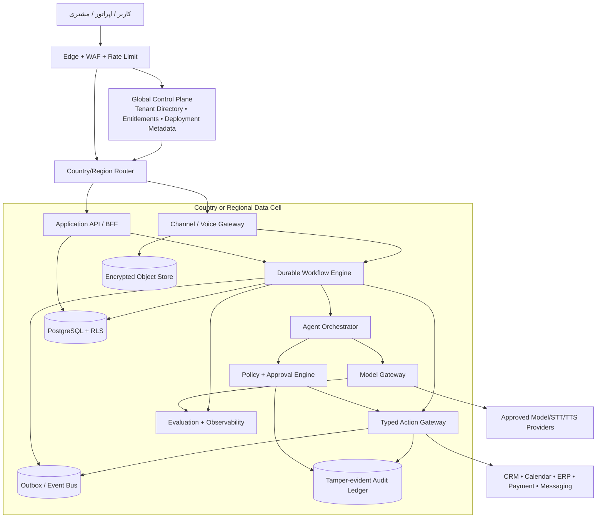
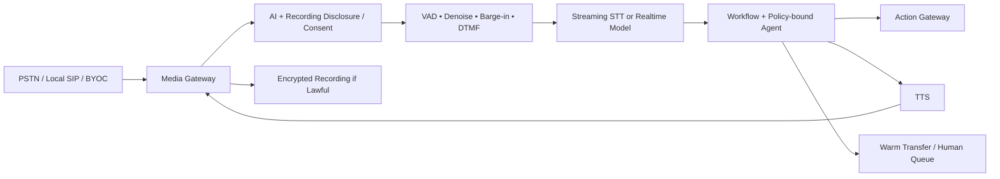

# گزارش تصمیم‌گیری بازار، محصول و معماری ManovaFlow

**تاریخ قطع پژوهش:** ۴ سپتامبر ۲۰۲۶  
**مخاطب:** بنیان‌گذار و معمار ارشد محصول  
**نوع سند:** پژوهش تصمیم‌محور؛ نه طرح اجرایی، نه ادعای آمادگی تولید، و نه مشاوره حقوقی  
**دامنه:** بازار، رقبا، راستی‌آزمایی Polsia، مرزبندی ماژول‌های افقی/عمودی، معماری چندمستاجری و چندکشوری، تماس صوتی چندزبانه، دسترسی تأمین‌کننده برای بنیان‌گذار ایرانی، حقوق، مدل کسب‌وکار، نقشه راه و دروازه‌های توقف

---

## ۱. حکم اجرایی

### تصمیم پیشنهادی

**ManovaFlow باید به‌عنوان «سکوی عملیات کنترل‌شده با عامل‌های هوش مصنوعی» ساخته شود؛ نه یک چت‌بات عمومی و نه یک شرکت کاملاً خودران.** هسته محصول افقی و قابل‌استفاده در چند صنعت باشد، اما ورود به بازار فقط با **یک کشور، یک عمودی و یک گردش‌کار قابل‌اندازه‌گیری** انجام شود.

گردش‌کار مرجع پیشنهادی:

> **از درخواست تا حل (Request-to-Resolution):** دریافت درخواست مشتری ← تشخیص هویت و رضایت ← طبقه‌بندی نیاز ← بازیابی دانش ← پیشنهاد یا اجرای اقدام مجاز ← تأیید انسانی در نقاط پرخطر ← ثبت نتیجه و شواهد ← پیگیری.

**INFERENCE — توصیه:** نقطه شروع مناسب برای اعتبارسنجی، کسب‌وکارهای خدماتی ۱۰ تا ۱۰۰ نفره با ۱ تا ۵ شعبه، حجم بالای تماس/پیام ورودی، رزرو یا اعزام نیروی قابل‌اندازه‌گیری و ریسک مقرراتی متوسط یا پایین است؛ نمونه مرجع، خدمات تعمیر و نگهداری ساختمان و تأسیسات است. سلامت، امور مالی، استخدام، اعتباردهی و مشاوره حقوقی باید از نسخه نخست خارج بمانند.

**INFERENCE — ترتیب بازار:** ترکیه می‌تواند بازار آزمایشی نخست باشد، اما فقط اگر تا پایان فاز صفر، شخصیت حقوقی و حساب بانکی مجاز، درگاه پرداخت، مسیر قانونی مدل هوش مصنوعی، اپراتور/شماره تلفن، مشاور محلی و دست‌کم پنج شریک طراحی به‌صورت مکتوب تأیید شوند. اگر هرکدام شکست خورد، بازار نخست باید بر اساس «قابلیت اجرای قانونی و فروش» عوض شود، نه بر اساس اندازه ظاهری بازار.

### آنچه اکنون باید و نباید ساخته شود

| تصمیم | حکم | دلیل |
|---|---|---|
| هسته مشترک چندمستاجری | **بساز، پس از دروازه فاز صفر** | جلوگیری از تکرار هویت، رضایت، حسابرسی، گردش‌کار، صورتحساب و اتصال‌دهنده‌ها |
| بسته عمودی واحد | **بساز** | رسیدن سریع به ارزش و معیارهای تکرارپذیر |
| بسته کشور واحد | **بساز** | زبان، رضایت، ساعات تماس، نگهداری داده، تلفن و پرداخت کشورمحورند |
| دموی فعلی اتوماسیون کلینیک | **فقط دارایی فروش و کشف؛ مبنای محصول نشود** | نمایشی، محلی و ساختگی است و backend، جداسازی داده و کنترل‌های تولید ندارد |
| عامل‌های خودمختار با دسترسی مستقیم به ابزارها | **نساز** | تزریق پرامپت، افشای داده، اقدام اشتباه و مسئولیت حقوقی |
| تماس خروجی سرد | **نساز** | رضایت، فهرست عدم تماس، شناسه تماس‌گیرنده و قوانین محلی پرریسک‌اند |
| تماس ورودی صوتی از روز اول | **به تعویق بینداز** | ابتدا متن و معیارهای حل درخواست؛ سپس آزمایش صوت محدود |
| «۹ عامل ثابت» یا وعده «شرکت بدون کارمند» | **ادعا نکن** | مبنای رسمی قابل راستی‌آزمایی و تناسب محصولی ندارد |
| سهم از درآمد مشتری در نسخه نخست | **نگیر** | انتساب، استرداد، مالیات، تسویه و ریسک پرداخت را پیچیده می‌کند |

### تعریف موفقیت دوازده‌ماهه

**INFERENCE — هدف تصمیمی، نه پیش‌بینی:** موفقیت یعنی حداقل پنج مشتری پرداخت‌کننده در یک عمودی و یک کشور، سه تمدید قابل‌اثبات، ارزش اقتصادی حداقل دو برابر هزینه ماهانه برای اکثر مشتریان، حاشیه سود ناخالص ترکیبی حداقل ۷۰٪، صفر رخداد جدی جداسازی مستاجر/رضایت، و بیش از ۸۰٪ فرایندهای نصب بدون کدنویسی اختصاصی. اگر این شرایط برآورده نشوند، توسعه افقی یا کشور دوم توجیه ندارد.

---

## ۲. روش پژوهش و قرارداد شواهد

این گزارش منابع رسمی و اولیه را بر منابع ثانویه مقدم کرده است. قیمت، پشتیبانی کشور و مقررات تا تاریخ قطع پژوهش بررسی شده‌اند، اما همگی می‌توانند تغییر کنند و پیش از قرارداد یا عرضه باید دوباره کنترل شوند.

برچسب‌های شواهد:

- **FACT / PROVEN:** در منبع رسمی، متن قانون، سند محصول یا داده قابل مشاهده تأیید شده است.
- **CLAIM:** ادعای شرکت، بنیان‌گذار، سرمایه‌گذار یا مصاحبه است و حسابرسی مستقل آن در دسترس نیست.
- **INFERENCE:** نتیجه تحلیلی این گزارش از چند شاهد یا از مدل اقتصادی است.
- **UNKNOWN / NOT_CAPTURED:** منبع کافی، داده حسابرسی‌شده یا پاسخ حقوقی قطعی پیدا نشده است.

اصل مهم: «وجود یک قابلیت در صفحه فروش» اثبات کیفیت، انطباق حقوقی، پایداری، دسترس‌پذیری در یک کشور، یا آمادگی تولید نیست. همچنین، تکرار یک عدد توسط سرمایه‌گذار یا رسانه، آن را به صورت مالی حسابرسی‌شده تبدیل نمی‌کند.

---

## ۳. بازار و تعریف دسته محصول

### ۳.۱ چرا اکنون؟

**FACT / PROVEN:** طبق گزارش ۲۰۲۵ سازمان همکاری و توسعه اقتصادی، استفاده از هوش مصنوعی در شرکت‌های بزرگ کشورهای OECD حدود ۴۰٪، در شرکت‌های متوسط ۲۰٫۴٪ و در شرکت‌های کوچک ۱۱٫۹٪ بوده است؛ همان گزارش نشان می‌دهد استفاده در فعالیت‌های اصلی کسب‌وکار هنوز پایین است و در کشورهای G7 در سال ۲۰۲۴ حدود ۱٫۹ تا ۶٫۱٪ گزارش شده است. بازاریابی و فروش از حوزه‌هایی است که بنگاه‌های کوچک‌تر در آن استفاده بیشتری دارند. این شکاف، فرصت فروش «نتیجه عملیاتی محدود و قابل‌اندازه‌گیری» را نشان می‌دهد، نه اثبات تقاضا برای خودکارسازی کامل شرکت. [OECD، AI adoption by SMEs](https://www.oecd.org/en/publications/ai-adoption-by-small-and-medium-sized-enterprises_426399c1-en.html)

**FACT / PROVEN:** بنگاه‌های کوچک و متوسط بیش از ۹۹٪ شرکت‌ها و حدود ۶۰٪ اشتغال بخش کسب‌وکار در OECD را تشکیل می‌دهند؛ بنابراین بازار بالقوه بزرگ است، ولی پراکندگی، بودجه محدود و هزینه پشتیبانی آن نیز بالاست. [OECD، Generative AI and the SME workforce](https://www.oecd.org/en/publications/generative-ai-and-the-sme-workforce_2d08b99d-en.html)

**FACT / PROVEN:** نظرسنجی McKinsey در ۲۰۲۵ می‌گوید نزدیک ۹۰٪ پاسخ‌دهندگان استفاده منظم از AI را در دست‌کم یک کارکرد گزارش کرده‌اند، ۶۲٪ سازمان‌ها دست‌کم در حال آزمایش عامل‌ها هستند، اما کمتر از ۱۰٪ در هر کارکرد مشخص به مقیاس رسیده‌اند و فقط ۳۹٪ اثر EBIT در سطح سازمان گزارش کرده‌اند. این داده نظرسنجی است، نه حسابرسی عملکرد همه شرکت‌ها. [McKinsey، State of AI 2025](https://www.mckinsey.com/capabilities/quantumblack/our-insights/the-state-of-ai)

**INFERENCE:** شکاف اصلی بازار «کمبود مدل زبانی» نیست؛ فاصله میان یک پاسخ هوشمند و یک عملیات ایمن، قابل تکرار، متصل به سیستم‌های واقعی و قابل حسابرسی است. پژوهش‌های McKinsey نیز تأکید می‌کنند که ارزش به بازطراحی گردش‌کار وابسته است و بخش بزرگی از فرصت بهره‌وری، ماهیت حوزه‌ای/صنعتی دارد. [McKinsey، Symbiotic enterprise](https://www.mckinsey.com/capabilities/quantumblack/our-insights/the-symbiotic-enterprise) و [Agents, robots, and us](https://www.mckinsey.com/mgi/our-research/agents-robots-and-us-skill-partnerships-in-the-age-of-ai)

### ۳.۲ دسته‌بندی درست

بازار فعلی پنج لایه دارد:

1. **عامل‌های داخل مجموعه‌های سازمانی:** Salesforce، Microsoft، ServiceNow و HubSpot؛ مزیت آن‌ها داده و توزیع موجود است.
2. **چسب اتوماسیون و گردش‌کار:** Zapier، Make و n8n؛ انعطاف بالا ولی نیازمند طراحی و نگهداری.
3. **همکاران یا تیم‌های AI بسته‌بندی‌شده:** Sintra، Lindy و Relevance AI؛ شروع سریع‌تر، اما عمق عملیات و کنترل سازمانی متفاوت.
4. **«شرکت خودران» عمومی:** Polsia؛ روایت بسیار گسترده و خودمختاری بالا.
5. **زیرساخت تخصصی صوت:** Retell، Vapi، Bland، Synthflow، Deepgram و ElevenLabs.

**INFERENCE — جایگاه پیشنهادی:** ManovaFlow باید بین لایه‌های ۲، ۳ و ۵ قرار گیرد، با تمایز زیر:

- خروجی آن «حل درخواست و ثبت نتیجه» است، نه تعداد پیام یا تعداد اجرای عامل؛
- هر اقدام بیرونی از دروازه سیاست و تأیید عبور می‌کند؛
- داده، مدل و تلفن قابل تعویض‌اند؛
- بسته‌های عمودی و کشوری بر یک هسته حسابرسی‌پذیر سوار می‌شوند؛
- محصول برای کسب‌وکار چندزبانه طراحی می‌شود، نه اینکه ترجمه به‌عنوان افزونه بعدی اضافه شود.

نام دسته پیشنهادی به فارسی: **سکوی عملیات کنترل‌شده با عامل‌های هوش مصنوعی**.  
نام انگلیسی پیشنهادی: **Controlled AI Operations Platform**.

### ۳.۳ مسئله خریدنی

مشتری برای «عامل» پول نمی‌دهد؛ برای کاهش تماس از دست‌رفته، کوتاه‌شدن زمان پاسخ، افزایش رزرو موفق، کاهش کار دستی، رعایت SLA و داشتن ردپای پاسخ‌گویی پول می‌دهد. بنابراین واحد ارزش باید یکی از این‌ها باشد:

- درخواست واجد شرایط و پاسخ‌داده‌شده؛
- رزرو یا اعزام تکمیل‌شده؛
- پرونده حل‌شده بدون بازگشایی؛
- دقیقه تماس ورودی به‌درستی مدیریت‌شده؛
- ساعت کار انسانی آزادشده، با خط مبنا و روش اندازه‌گیری توافق‌شده.

**UNKNOWN / NOT_CAPTURED:** هیچ داده اولیه‌ای از مشتریان ManovaFlow، نرخ تماس ازدست‌رفته، willingness-to-pay، چرخه فروش یا اندازه بازار قابل‌دسترس در این پژوهش وجود ندارد. بنابراین هر عدد TAM از بالا در این مرحله دقت کاذب ایجاد می‌کند. اندازه بازار باید پایین‌به‌بالا محاسبه شود: تعداد حساب‌های واقعاً قابل دسترس × نرخ تبدیل واقع‌بینانه × درآمد سالانه هر حساب.

---

## ۴. راستی‌آزمایی Polsia و Ben Cera/Broca

### ۴.۱ آنچه منابع رسمی واقعاً نشان می‌دهند

| موضوع | یافته | وضعیت شواهد |
|---|---|---|
| محصول | صفحه اصلی Polsia آن را AIای معرفی می‌کند که «شرکت را هنگام خواب اداره می‌کند» و حوزه‌هایی مانند نقشه راه، کد، تبلیغات، پشتیبانی، فروش و شبکه اجتماعی را نمایش می‌دهد. [وب‌سایت Polsia](https://polsia.com/) | **FACT / PROVEN** درباره نحوه معرفی؛ نه اثبات عملکرد |
| شرکت و شرایط | شرایط استفاده، نام Polsia, Inc.، اقدام‌های زمان‌بندی‌شده خودکار، استفاده از Stripe و مسئولیت قانونی کاربر را تصریح می‌کند. [Terms، به‌روزرسانی ۲۵ اوت ۲۰۲۶](https://polsia.com/terms) | **FACT / PROVEN** |
| سرمایه‌گذار | Polsia در پرتفوی رسمی True Ventures دیده می‌شود. [پرتفوی True Ventures](https://www.trueventures.com/) | **FACT / PROVEN** برای رابطه سرمایه‌گذاری |
| جذب سرمایه | بنیان‌گذار از جذب ۳۰ میلیون دلار با ارزش‌گذاری ۲۵۰ میلیون دلار و نرخ درآمد نزدیک ۱۰ میلیون دلار گفته است. [پست LinkedIn بنیان‌گذار](https://www.linkedin.com/posts/benbroca_today-im-announcing-that-polsia-raised-30m-activity-7463621327774588928-Yqgn) | **CLAIM**؛ سند تأمین مالی یا صورت مالی عمومی بررسی‌شده موجود نیست |
| رشد | True Ventures در مارس ۲۰۲۶ از ARR سه میلیون دلار، ۳۰۰۰ شرکت و یک شرکت یک‌نفره نوشته است. [یادداشت True Ventures](https://www.trueventures.com/blog/polsia-one-person-company-no-longer-a-metaphor) | **CLAIM** تکرارشده توسط سرمایه‌گذار؛ نه حسابرسی مستقل |
| جذب سرمایه توسط AI | بنیان‌گذار و مصاحبه GTMnow می‌گویند Polsia دیتاروم و فرایند بررسی سرمایه‌گذاری را اداره کرده است. [GTMnow](https://gtmnow.com/gtm-192-inside-the-company-that-raised-30m-at-a-250m-valuation-with-0-employees-ben-cera-polsia/) | **CLAIM** |
| «بدون کارمند» | منابع رسمی/نزدیک به شرکت این عبارت را به کار می‌برند؛ Crunchbase بازه ۱ تا ۱۰ نفر را نمایش می‌دهد. [Crunchbase](https://www.crunchbase.com/organization/polsia) | **CLAIM** و دارای ابهام تعریف نیروی انسانی/پیمانکار |
| تعداد عامل‌ها | صفحات رسمی، نقش‌های مهندسی، outreach، تبلیغ، تحقیق، پایش خطا، پشتیبانی، پرداخت و شبکه اجتماعی را ذکر می‌کنند. | **UNKNOWN / NOT_CAPTURED:** هیچ منبع رسمی معتبری «دقیقاً ۹ عامل» را تأیید نکرد |
| خودمختاری | Deck می‌گوید عملیات شرکت خودکار است و در یک بخش «۸۰٪ خودمختار» را بیان می‌کند. [Deck رسمی](https://polsia.com/deck) | **CLAIM**؛ تعریف مخرج، نمونه و خطا منتشر نشده |

### ۴.۲ اعداد عملکرد و کیفیت شواهد

**CLAIM:** Deck رسمی، راه‌اندازی در دسامبر ۲۰۲۵ و یک تصویر هشت‌هفته‌ای شامل ARR برابر ۲۲۸٬۸۲۰ دلار، ۴۷۷ شرکت فعال، ۴۵٬۴۳۶ پیام انسانی، ۲۲٬۸۹۱ وظیفه و ۱۵٬۸۲۳ ایمیل را نمایش می‌دهد. این اعداد خوداظهاری‌اند، دوره و تعریف دقیق cohort، churn، gross margin و روش حسابرسی منتشر نشده است. [Deck رسمی Polsia](https://polsia.com/deck)

**CLAIM:** همان Deck می‌گوید «پلتفرم خودش را می‌سازد»، حافظه بین‌شرکتی دارد و از اشتراک، اعتبار وظیفه، تبلیغات مدیریت‌شده، خریدوفروش شرکت و سهم پرداخت درآمد کسب می‌کند. این موارد اثبات معماری، جداسازی داده مستاجران یا رضایت مشتریان برای یادگیری بین‌شرکتی نیستند.

**UNKNOWN / NOT_CAPTURED:** موارد زیر از منابع عمومی بررسی‌شده به دست نیامدند:

- صورت مالی حسابرسی‌شده، مانده نقدی یا درآمد شناسایی‌شده؛
- retention خالص/ناخالص، churn cohort و نرخ بازگشت وجه؛
- حاشیه سود پس از هزینه مدل، تبلیغ، پشتیبانی و بازبینی انسانی؛
- نرخ اقدام اشتباه، حادثه امنیتی، prompt injection و نقض مجوز؛
- تعداد پیمانکاران، اپراتورهای انسانی و ساعات مداخله؛
- معماری واقعی جداسازی مستاجر و سیاست استفاده از «حافظه بین‌شرکتی»؛
- مراجع مشتری مستقلی که نتیجه اقتصادی را مستند کرده باشند؛
- پوشش حقوقی کشوربه‌کشور برای ایمیل سرد، تبلیغ، پرداخت و پیام عمومی.

### ۴.۳ تناقض مهم قیمت‌گذاری

| منبع | بیان عمومی | تاریخ/وضعیت | نتیجه |
|---|---|---|---|
| [Terms Polsia](https://polsia.com/terms) | ۳٪ از پرداخت‌های مشتری؛ تسویه ۳۱روزه؛ حداقل برداشت ۵۰ دلار؛ سقف برداشت ماهانه ۵۰۰ دلار؛ ۲۰٪ هزینه روی هزینه تبلیغ | به‌روزرسانی ۲۵ اوت ۲۰۲۶ | **FACT / PROVEN** درباره متن فعلی شرایط |
| [راهنمای دریافت پرداخت](https://help.polsia.com/accept-payments-on-your-site) | ۲۰٪ از هر پرداخت و ۸۰٪ برای کاربر | صفحه راهنما | **FACT / PROVEN** درباره متن صفحه؛ متناقض با Terms |
| [Deck رسمی](https://polsia.com/deck) | ۳٪ سهم پرداخت، به‌علاوه چند جریان درآمدی دیگر | خوداظهاری | **CLAIM** درباره مدل اقتصادی |

**نتیجه:** افشای عمومی کارمزد پرداخت Polsia سازگار نیست. جدیدتر بودن Terms می‌تواند نشان‌دهنده تغییر محصول باشد، اما این فقط **INFERENCE** است. مبلغ واقعاً اعمال‌شده باید داخل محصول و قرارداد هر حساب کنترل شود. استفاده از عدد ۳٪ یا ۲۰٪ بدون این قید، گمراه‌کننده است.

### ۴.۴ نام بنیان‌گذار

در منابع مختلف نام‌های **Ben Cera، Ben Broca** و در روایت‌های رسمی‌تر **Victor-Benjamin/Ben** دیده می‌شود. **FACT / PROVEN:** پروفایل‌ها و مطالب رسمی این نام‌ها را به یک روایت بنیان‌گذار پیوند می‌دهند. **UNKNOWN / NOT_CAPTURED:** این پژوهش سند هویتی یا توضیح رسمی تغییر نام را بررسی نکرده است؛ بنابراین نباید از این تفاوت نتیجه منفی یا حقوقی گرفت.

### ۴.۵ درس برای ManovaFlow

آنچه ارزش الگوبرداری دارد:

- یک نتیجه روایی ساده و جسورانه؛
- شروع سریع و حلقه بازخورد کوتاه؛
- اتصال عملیات، فروش، پشتیبانی و پرداخت در یک تجربه؛
- خودکارسازی ساخت و نگهداری محصول به‌عنوان اهرم داخلی.

آنچه نباید کپی شود:

- خودمختاری باز و تعریف‌نشده؛
- دسترسی مستقیم عامل به تبلیغ، پرداخت یا پیام عمومی؛
- حافظه بین‌مستاجری بدون قرارداد داده شفاف؛
- قیمت‌گذاری و کارمزدهای متناقض؛
- استفاده از ARR و «بدون کارمند» به‌عنوان جایگزین retention، حاشیه سود و کیفیت اقدام؛
- تعمیم یک مدل عمومی به کشورهای دارای قواعد رضایت و ارتباطات متفاوت.

**حکم:** Polsia اثبات می‌کند روایت «عملیات با AI» توجه بازار و سرمایه را جلب می‌کند؛ اثبات نمی‌کند که یک سیستم عمومی و کاملاً خودران، ایمن، سودآور، قابل‌تکرار یا سازگار با کشورهای هدف ManovaFlow است.

---

## ۵. نقشه رقبا و اقتصاد قیمت‌گذاری

قیمت‌ها snapshot عمومی در تاریخ قطع پژوهش‌اند؛ مالیات، مصرف مازاد، مدل انتخابی، قرارداد سازمانی، تلفن و دوره پرداخت ممکن است آن‌ها را تغییر دهند.

| محصول | دسته و نقطه قوت | قیمت یا واحد عمومی | درس معماری/بازار |
|---|---|---|---|
| Salesforce Agentforce | عامل در CRM و داده سازمانی | Foundations رایگان؛ ۵۰۰ دلار برای ۱۰۰هزار اعتبار؛ اقدام استاندارد ۲۰ اعتبار و صوت ۳۰ اعتبار؛ گزینه ۲ دلار برای مکالمه؛ افزونه‌های کاربری از ۱۲۵/۱۵۰ دلار و Agentforce 1 از ۵۵۰ دلار/کاربر/ماه. [قیمت رسمی](https://www.salesforce.com/agentforce/pricing/) | توزیع و داده موجود مزیت اصلی است؛ قیمت اعتباری می‌تواند برای خریدار مبهم شود |
| Microsoft Copilot Studio | ساخت عامل، IVR و هماهنگی چندعامل در اکوسیستم Microsoft | ۲۰۰ دلار/ماه برای ۲۵هزار Copilot Credit؛ پرداخت به‌ازای مصرف/پیش‌خرید و نیاز به Azure subscription. [قیمت رسمی](https://www.microsoft.com/en-us/microsoft-365-copilot/pricing/copilot-studio) | رقابت مستقیم در حساب‌های Microsoft؛ ManovaFlow باید نتیجه عمودی و راه‌اندازی ساده‌تر بفروشد |
| ServiceNow CSM | پرونده، omnichannel، صدای بومی، governance سازمانی | قیمت سفارشی. [صفحه رسمی CSM](https://www.servicenow.com/products/customer-service-management/pricing.html) | الگوی قوی برای case/SLA/audit؛ برای SMB سنگین‌تر است |
| HubSpot Customer Agent | عامل داخل بازاریابی/فروش/سرویس HubSpot | اعتبار ۰٫۰۱ دلار؛ یک resolution عامل مشتری ۵۰ اعتبار، تقریباً ۰٫۵۰ دلار. [کاتالوگ رسمی](https://legal.hubspot.com/hubspot-product-and-services-catalog) | «حل‌شدن» واحد قیمت قابل‌فهم‌تری از توکن است |
| Zapier Agents | دسترسی به اکوسیستم اتصال‌دهنده وسیع | Zapier رایگان ۱۰۰ task/ماه؛ Agents بیش از ۹۰۰۰ اپ را تبلیغ می‌کند. [قیمت Zapier](https://zapier.com/pricing) و [Agents](https://zapier.com/agents) | اتصال‌دهنده مزیت است، اما کنترل دامنه و حسابرسی باید ارزش افزوده ManovaFlow باشد |
| Make | اتوماسیون بصری ارزان | رایگان ۱۰۰۰ credit؛ در نمایش ماهانه Core حدود ۱۲، Pro حدود ۲۱ و Teams حدود ۳۸ دلار برای ۱۰هزار credit. [قیمت رسمی](https://www.make.com/en/pricing) | کف قیمت اجرای خام پایین است؛ محصول باید outcome و تخصص عمودی بفروشد |
| n8n | گردش‌کار توسعه‌پذیر و self-hosted | Starter حدود ۲۰ یورو/ماه سالانه برای ۲۵۰۰ execution؛ Pro حدود ۵۰ یورو/۱۰هزار؛ Business self-hosted حدود ۶۶۷ یورو/۴۰هزار؛ Enterprise سفارشی. [قیمت رسمی](https://n8n.io/pricing) | گزینه ساخت/همکاری برای orchestration غیرحساس؛ قفل‌شدن در منطق اختصاصی پرهزینه است |
| Relevance AI | workforce/agent platform | رایگان ۲۰۰ action؛ Pro حدود ۱۹ دلار سالانه یا ۲۹ ماهانه؛ Team حدود ۲۳۴ سالانه یا ۳۴۹ ماهانه. [قیمت](https://relevanceai.com/pricing) و [مستندات](https://relevanceai.com/docs/get-started/pricing) | **UNKNOWN / NOT_CAPTURED:** دو صفحه برای ۱۰۰۰ action اضافه، ۴۰ و ۸۰ دلار نشان می‌دهند؛ قبل از مقایسه خرید باید تأیید شود |
| Sintra | بسته «۱۲ helper» برای SMB | قیمت استاندارد راهنما ۹۷ دلار ماهانه، ۱۷۷ دلار سه‌ماهه و ۶۲۴ دلار سالانه با ۲۵۰ اعتبار. [راهنمای رسمی](https://help.sintra.ai/en/articles/9607367-plans-and-pricing)؛ صفحه فروش فعلی تخفیف‌های بزرگ نشان می‌دهد. [صفحه تبلیغاتی](https://sintra.ai/pricing-26) | بسته نقش‌ها پیام ساده دارد، ولی تخفیف مداوم می‌تواند anchoring را مخدوش کند |
| Lindy | inbox، جلسه، تقویم، follow-up و امکانات سازمانی | حدود ۴۹٫۹۹، ۹۹٫۹۹ و ۱۹۹٫۹۹ دلار ماهانه؛ Enterprise سفارشی؛ امکانات سازمانی شامل SSO/SCIM/audit و گزینه‌های انطباق. [مستندات قیمت](https://docs.lindy.ai/pricing) | ورود از گردش‌کار مشخص بهتر از ادعای عامل عمومی است |
| Polsia | روایت شرکت خودران | مدل عمومی چندبخشی؛ کارمزد پرداخت عمومی متناقض ۳٪/۲۰٪؛ God Mode خوداظهاری ۱۹ دلار/ساعت و کمتر از ۶ دلار/ساعت برای اجرای هفتگی. [God Mode](https://polsia.com/blog/i-unlocked-god-mode) | روایت قوی، اما شفافیت هزینه، کنترل و retention برای تصمیم خرید کافی نیست |
| Retell | زیرساخت عامل صوتی | حدود ۰٫۰۷ تا ۰٫۳۱ دلار/دقیقه، ۱۰ دلار رایگان و ۲۰ تماس همزمان؛ تلفن جدا. [قیمت رسمی](https://www.retellai.com/pricing) | مرجع build-vs-buy و هزینه متغیر صوت |
| Vapi | orchestration صوتی و BYOK | ۰٫۰۵ دلار/دقیقه میزبانی، هزینه ارائه‌دهندگان جدا، ۱۰ concurrency و هر خط افزوده ۱۰ دلار/ماه؛ HIPAA و ZDR افزونه‌های گران. [قیمت رسمی](https://vapi.ai/pricing) | جداسازی هزینه orchestration از STT/TTS/LLM/telephony ضروری است |
| Bland | عامل تماس بسته‌بندی‌شده | پلن‌های رایگان، ۲۹۹ و ۴۹۹ دلار؛ حدود ۰٫۱۴/۰٫۱۲/۰٫۱۱ دلار به‌ازای دقیقه متصل. [مستندات Billing](https://docs.bland.ai/platform/billing) | دقیقه متصل باید در مدل gross margin لحاظ شود |
| Synthflow | voice automation سازمانی | Enterprise از حدود ۳۰هزار دلار سالانه؛ self-serve متغیر است. [قیمت رسمی](https://synthflow.ai/pricing) | بازار enterprise حاضر است برای governance و SLA هزینه کند |
| Deepgram Voice Agent | API صوت end-to-end | ۴٫۵۰ دلار/ساعت، معادل ۰٫۰۷۵ دلار/دقیقه. [صفحه رسمی](https://deepgram.com/product/voice-agent-api) | کف ساده برای برآورد موتور صوت، بدون تلفن و عملیات |

**FACT / PROVEN — ریسک تأمین‌کننده:** Relay.app اعلام کرده سرویس رایگان در ۱۵ اوت ۲۰۲۶ و سرویس پولی در ۱۴ سپتامبر ۲۰۲۶ متوقف می‌شود و داده‌ها حذف خواهند شد. [اعلام رسمی Relay](https://relay.app/) این نمونه نشان می‌دهد export، abstraction و برنامه خروج از تأمین‌کننده الزام معماری است، نه بهبود اختیاری.

### نتیجه رقابتی

**INFERENCE:** ManovaFlow با «سازنده عامل عمومی» مزیت پایدار نمی‌سازد؛ این سطح هم از طرف suiteهای بزرگ و هم ابزارهای ارزان اتوماسیون فشرده است. مزیت باید از ترکیب چهار دارایی شکل گیرد:

1. گردش‌کار عمودی با معیار اقتصادی روشن؛
2. بسته انطباق و عملیات کشور؛
3. action gateway و شواهد حسابرسی؛
4. داده ارزیابی‌شده از خطاها و نتایج همان عمودی، بدون مخلوط‌کردن داده مستاجران.

---

## ۶. مرز محصول: هسته، بسته عمودی و بسته کشور

### ۶.۱ هسته مشترک بین صنایع

| ماژول هسته | مسئولیت | آنچه نباید در آن سخت‌کد شود |
|---|---|---|
| سازمان و مستاجر | tenant، شعبه، تیم، کاربر، نقش، entitlement، طرح | نقش‌های خاص یک صنعت یا قانون یک کشور |
| هویت و دسترسی | OIDC/SAML، MFA، RBAC/ABAC، session، service account | credential مشترک بین مستاجران |
| مشتری و رضایت | شخص/سازمان، کانال، purpose، رضایت، لغو، suppression | فرض رضایت سراسری یا دائمی |
| صندوق ورودی و مکالمه | email/web/chat/voice، thread، participant، handoff | قالب یا taxonomy یک عمودی |
| درخواست/پرونده | case، priority، SLA، وضعیت، مالک، outcome | معنای «حل» بدون بسته عمودی |
| دانش و منشأ | سند، نسخه، اعتبار، scope، citation، تاریخ انقضا | استفاده از متن بدون منبع یا مجوز |
| گردش‌کار و وظیفه | state machine، queue، timer، retry، compensation | کنترل جریان توسط متن آزاد عامل |
| سیاست و تأیید | risk tier، rule، approver، budget، segregation of duties | مجوز کلی «همه ابزارها» |
| اتصال‌دهنده و راز | OAuth، vault، scope، rotation، webhook، idempotency | کلید API در prompt یا log |
| مدل و عامل | registry، routing، prompt version، evaluation، fallback | وابستگی به یک مدل یا ارائه‌دهنده |
| مصرف و صورتحساب | meter، ledger، quota، invoice input، cost allocation | صورتحساب بر اساس تخمین غیرقابل بازسازی |
| حسابرسی و چرخه داده | append-only audit، retention، legal hold، export/delete | log شامل PII کامل یا chain-of-thought |
| محلی‌سازی | locale، timezone، currency، number/date format، glossary | ترجمه تحت‌اللفظی بدون context |
| ارتباطات و صوت | channel adapter، شماره، media session، recording policy | فرض برابری قواعد تماس در همه کشورها |

### ۶.۲ بسته عمودی

هر بسته عمودی باید یک افزونه پیکربندی‌شده و نسخه‌پذیر باشد، نه fork محصول. محتوا:

- مدل دامنه و موجودیت‌های تخصصی؛
- taxonomy درخواست‌ها، intentها و وضعیت‌های حل؛
- فرم‌ها، نماها و واژگان تخصصی؛
- گردش‌کارها، SLAها و نقاط تأیید؛
- connectorهای ضروری آن صنعت؛
- سیاست نگهداری و محدودیت داده؛
- KPI و مجموعه ارزیابی اختصاصی؛
- الگوهای دانش، پاسخ و گزارش؛
- مرزهای ممنوعه و مسیر escalation انسانی.

برای عمودی مرجع «تعمیر و نگهداری/خدمات میدانی»، موجودیت‌های اختصاصی می‌توانند `ServiceLocation`، `Asset`، `WorkOrder`، `Technician`، `Skill`، `TimeSlot`، `Quote` و `VisitOutcome` باشند. اقدام‌های اصلی: عیب‌یابی اولیه غیرتشخیصی، گرفتن اطلاعات، اولویت‌بندی ایمنی، رزرو، اعزام، اعلام ETA، تهیه پیش‌نویس برآورد، پیگیری و بستن سفارش.

**INFERENCE:** قیمت نهایی، تعهد حقوقی، تشخیص ایمنی، بازپرداخت و تغییر برنامه پرهزینه باید از عامل به انسان یا سیاست قطعی منتقل شود.

### ۶.۳ بسته کشور

هر کشور نیازمند نسخه مستقل از موارد زیر است:

- زبان‌ها، لهجه‌ها، تقویم، منطقه زمانی، ارز و قالب آدرس/تلفن؛
- متن disclosure هوش مصنوعی و ضبط مکالمه؛
- purpose و کانال رضایت، فهرست عدم تماس و دوره اعتبار؛
- ساعات و سقف تکرار ارتباط؛
- قواعد caller ID، شماره محلی و اپراتور؛
- محل نگهداری، retention، export/delete و پاسخ به حقوق داده؛
- مسیر پرداخت، مالیات و صدور صورتحساب؛
- ارائه‌دهندگان مجاز مدل، پیام و تلفن؛
- الگوی قرارداد و DPA؛
- قوانین ممنوعیت workflow و ریسک.

بسته کشور نباید صرفاً فایل ترجمه باشد. یک `policy bundle` امضاشده و نسخه‌پذیر است که اجرای workflow بدون نسخه معتبر آن ممکن نباشد.

### ۶.۴ نقش‌های عامل پیشنهادی

نقش‌ها قرارداد توانمندی‌اند، نه شخصیت‌های بازاری ثابت:

1. **Intake/Reception Agent:** دریافت، disclosure، رضایت، احراز سبک و ساخت درخواست.
2. **Resolver Agent:** بازیابی دانش، پیشنهاد پاسخ و برنامه اقدام.
3. **Scheduler/Dispatcher Agent:** یافتن slot/نیرو و ایجاد پیش‌نویس رزرو یا اعزام.
4. **Follow-up Agent:** پیگیری رضایت‌محور، جمع‌آوری نتیجه و بازگشایی کنترل‌شده.
5. **QA/Compliance Agent:** کنترل منبع، سیاست، PII، لحن و تکمیل شواهد؛ حق اجرای اقدام بیرونی ندارد.

**INFERENCE:** تعداد نقش‌ها باید از workflow استخراج شود. تبلیغ «۹ عامل» باعث می‌شود ساختار داخلی به تعهد محصولی بی‌دلیل تبدیل شود.

---

## ۷. گزینه‌های راهبردی

امتیاز ۱ ضعیف تا ۵ قوی است. وزن‌ها برای مرحله پیش‌درآمد ManovaFlow پیشنهاد شده‌اند.

| گزینه | سرعت یادگیری ۲۰٪ | تمایز ۲۰٪ | تکرارپذیری ۲۰٪ | ریسک حقوقی/عملیاتی ۲۰٪ | سرمایه موردنیاز ۱۰٪ | توزیع ۱۰٪ | امتیاز وزنی |
|---|---:|---:|---:|---:|---:|---:|---:|
| A. شرکت خودران عمومی شبیه Polsia | 2 | 3 | 1 | 1 | 1 | 3 | **1.9/5** |
| B. هسته افقی + یک بسته عمودی/کشوری | 4 | 4 | 4 | 4 | 3 | 3 | **3.8/5** |
| C. پلتفرم توسعه‌دهنده برای orchestration عامل | 3 | 2 | 4 | 3 | 3 | 2 | **2.9/5** |
| D. آژانس مدیریت‌شده عملیات AI | 5 | 3 | 2 | 3 | 4 | 3 | **3.4/5** |

### گزینه B — توصیه اصلی

هسته مشترک و استاندارد ساخته می‌شود، اما فروش و ارزیابی به یک outcome عمودی محدود می‌ماند. این گزینه میان یادگیری، محصول‌پذیری و ریسک تعادل دارد.

### نقش محدود گزینه D

**INFERENCE:** در سه تا پنج پایلوت نخست می‌توان تجربه مشتری را به‌صورت سرویس مدیریت‌شده ارائه کرد تا داده و نیاز واقعی جمع شود؛ اما هر استثنا باید ثبت و هر کار دستی باید در هزینه ارائه خدمت منظور شود. اگر پس از مشتری سوم بیش از ۲۰٪ گردش‌کارها کدنویسی اختصاصی بخواهند، محصول در حال تبدیل‌شدن به آژانس است و باید متوقف یا آگاهانه بازتعریف شود.

### چرا گزینه A فعلاً رد می‌شود

- سطح حمله و مسئولیت همه واحدهای شرکت را یک‌جا وارد می‌کند؛
- اعتبارسنجی ارزش هر ماژول را ناممکن می‌کند؛
- سرمایه، داده و تیمی فراتر از مرحله فعلی می‌خواهد؛
- قوانین پیام، پرداخت، تبلیغ و تصمیم‌گیری خودکار با هم جمع می‌شوند؛
- یک خطای عامل می‌تواند اعتبار کل برند را نابود کند.

### مطالعه موردی تصمیمی: دموی اتوماسیون کلینیک

#### وضعیت قابل اتکا و مرز شواهد

گزارش ممیزی تحویلی، یک دموی پیشرفته فارسی/راست‌به‌چپ با هشت مسیر، سه پروفایل، persistence مرورگری با `localStorage` و داده کاملاً ساختگی را توصیف می‌کند. در همان گزارش، ۲۳۳ تست و عبور build/typecheck ثبت شده است.

این شواهد باید دقیقاً چنین تفسیر شوند:

| گزاره | برچسب | تفسیر مجاز |
|---|---|---|
| هشت مسیر، سه پروفایل و تجربه فارسی/RTL در دمو وجود دارد | **FACT / PROVEN** در محدوده گزارش ممیزی تحویلی | قابلیت نمایشی و پوشش سناریو؛ نه سرویس زنده |
| داده‌ها ساختگی و persistence در `localStorage` است | **FACT / PROVEN** | برای نمایش محلی مناسب؛ برای داده واقعی نامناسب |
| ۲۳۳ تست و build/typecheck ثبت شده‌اند | **FACT / PROVEN** در گزارش تحویلی، نه اجرای مستقل این پژوهش | اثبات regressionهای پوشش‌داده‌شده همان نسخه؛ نه امنیت، browser matrix یا تولید |
| وضعیت زنده و ماتریس کامل مرورگر تأیید نشده است | **UNKNOWN / NOT_CAPTURED** | هیچ ادعای availability، سازگاری کامل یا demo-live مجاز نیست |
| سه تغییر commit‌نشده وجود دارد | **FACT / PROVEN** در گزارش تحویلی | نسخه قابل نمایش هنوز هویت release قطعی و بازتولیدپذیر ندارد |
| backend، PostgreSQL، auth/RBAC، API امن، queue، webhook، backup، monitoring، audit تغییرناپذیر و secrets management وجود ندارند | **FACT / PROVEN** در محدوده ممیزی تحویلی | این دمو زیرساخت یک محصول قابل استفاده با داده واقعی نیست |

یک یادداشت ممیزی تاریخی پیشین، ۲۳۲ تست موفق و build/typecheck را ثبت کرده بود، اما دروازه نهایی را به‌علت برخورد قابل‌بازتولید فرمان تعویض پروفایل با پیام `Stale system command` متوقف کرده بود. گزارش تحویلی جدید عدد ۲۳۳ و سه تغییر commit‌نشده را بیان می‌کند. **UNKNOWN / NOT_CAPTURED:** بدون بازاجرای نسخه دقیق، معلوم نیست تست افزوده همان نقص را پوشش داده، نقص رفع شده، یا تغییرات دیگری در کار است. این تفاوت الزام freeze کردن نسخه را تقویت می‌کند و نباید به‌عنوان شکست یا رفع قطعی تفسیر شود.

#### پاسخ ۱ — دارایی فروش یا مبنای محصول؟

**حکم:** دمو باید **دارایی فروش، کشف نیاز و پایلوت نمایشی** بماند؛ نباید مبنای runtime یا data architecture محصول شود.

دلایل:

- state و اعتماد در مرورگر قرار دارد و مرز امنیتی سرور وجود ندارد؛
- `localStorage` جداسازی tenant، کنترل دسترسی، encryption at rest، retention، restore یا audit معتبر نمی‌دهد؛
- داده ساختگی و simulation هیچ نتیجه بالینی/عملیاتی واقعی را اثبات نمی‌کند؛
- نبود API/queue/webhook مانع اجرای قابل اتکای side effect و reconciliation است؛
- نبود secrets، monitoring و backup، مسیر incident response را حذف می‌کند؛
- حوزه سلامت، داده ویژه و مسئولیت بیشتری نسبت به wedge پیشنهادی کم‌ریسک دارد؛
- سه تغییر commit‌نشده و browser matrix ناقص، حتی release نمایشی را نیازمند freeze مجدد می‌کند.

این حکم به معنی دورریختن دمو نیست. ارزش آن در تجربه بصری، داستان محصول، taxonomy سناریو و آزمون فهم مشتری است؛ نه در تبدیل `localStorage` به دیتابیس با چند endpoint الحاقی.

#### پاسخ ۲ — کم‌هزینه‌ترین مسیر به نخستین پیشنهاد قابل‌فروش

کم‌هزینه‌ترین پیشنهاد قابل‌فروش، فروش دسترسی به نرم‌افزار سلامت نیست؛ یک **Clinic Operations Discovery Sprint** پولی و محدود است:

1. جلسه کشف workflow و اندازه‌گیری دردهای اداری با داده تجمیعی، بدون پرونده بیمار؛
2. نمایش کنترل‌شده دمو با داده کاملاً ساختگی و سناریوی متناسب با نوع کلینیک؛
3. تحویل نقشه جریان درخواست/نوبت/پیگیری، خط مبنای KPI، ماتریس ریسک و ROI model؛
4. تعیین مرز خودکارسازی R0 تا R4 و فهرست نقاط تأیید انسانی؛
5. پیشنهاد یک پایلوت shadow آینده، مشروط به عبور کنترل‌های داده و حقوقی.

این بسته «خدمت کشف و طراحی» است، نه SaaS تولیدی. می‌توان آن را بدون دریافت نام، شماره، پرونده، تشخیص، تصویر، صدای بیمار یا credential سیستم کلینیک فروخت. مشتری فقط اعداد تجمیعی و الگوی فرایند می‌دهد؛ سناریو در دمو با داده مصنوعی بازسازی می‌شود.

پیش از هر نمایش بیرونی، در یک اقدام مستقل و با مجوز جدا باید:

- سه تغییر commit‌نشده تعیین تکلیف و یک نسخه immutable شناسه‌دار freeze شود؛
- ۲۳۳ تست، build، typecheck، ماتریس مرورگر و خطاهای console روی همان hash دوباره اجرا شوند؛
- نقص تاریخی تعویض سریع پروفایل به‌طور مشخص regression-test شود؛
- demo badge دائمی و عبارت «داده ساختگی؛ بدون اتصال واقعی» در همه مسیرها باقی بماند؛
- snapshot قابل بازنشانی قبل از هر جلسه وجود داشته باشد.

**INFERENCE — ارزان‌ترین پایلوت نرم‌افزاری بعدی:** اگر مشتری بعد از Sprint پایلوت واقعی بخواهد، UI دمو فقط client یک vertical pack اداری کلینیک بر هسته امن ManovaFlow باشد. backend نباید داخل دمو وصله شود. برای یک مشتری نخست می‌توان data plane را به‌صورت silo اختصاصی اجرا کرد، ولی قراردادهای tenant، هویت، رضایت و audit باید همان قراردادهای هسته باشند تا مهاجرت به سلول مشترک ممکن بماند.

دامنه آن پایلوت باید فقط عملیات اداری کم‌ریسک مانند intake غیرپزشکی، زمان‌بندی، یادآوری رضایت‌محور و صف پیگیری باشد. تشخیص، تریاژ بالینی، توصیه درمانی، تصمیم بیمه/اعتبار و اقدام مستقل مالی خارج از دامنه بمانند.

#### پاسخ ۳ — قابلیت‌هایی که بعداً به هسته ManovaFlow منتقل می‌شوند

انتقال باید بر اساس **مفهوم و قرارداد** باشد، نه کپی مستقیم state محلی.

| دارایی دمو | مقصد | نوع استفاده |
|---|---|---|
| الگوهای RTL، navigation و responsive layout | Design system هسته | قابل انتقال پس از accessibility/browser audit |
| هشت مسیر و information architecture | shell محصول و vertical route registry | استخراج الگو؛ نام‌های کلینیکی در vertical pack بمانند |
| سه پروفایل | tenant/vertical presentation profiles | تبدیل به تنظیمات نسخه‌پذیر؛ نه شرط‌های پراکنده در UI |
| patient/workflow state machine نمایشی | `WorkflowDefinition` و `WorkflowRun` | بازطراحی server-side با idempotency، policy و durable execution |
| automation control center | workflow/approval console | الگوی UX ارزشمند؛ اجرا فقط از API و action gateway |
| timeline، evidence و trace نمایشی | audit/evidence viewer | UI قابل استفاده؛ منبع داده باید append-only و سروری باشد |
| fixture و سناریوهای ساختگی | demo tenant و evaluation fixtures | حفظ به‌عنوان مجموعه synthetic و بدون PHI |
| تست‌های رفتار UI | contract/regression suite | نگاشت به قراردادهای جدید؛ عدد تست به‌تنهایی منتقل نمی‌شود |
| سوئیچ پروفایل و command receipt | command/idempotency contract | مفهوم قابل انتقال؛ implementation محلی و نقص تاریخی کپی نشود |
| واژگان، صف‌ها و موجودیت‌های بیمار/کلینیک | `clinic-admin` vertical pack | از هسته عمومی جدا؛ مشمول policy و retention سلامت |

مواردی که نباید به هسته منتقل شوند:

- `localStorage` به‌عنوان منبع حقیقت؛
- شناسه یا مجوز تولیدشده در client؛
- audit قابل ویرایش مرورگر؛
- داده یا schema بیمار در جدول‌های عمومی هسته؛
- profile logic سخت‌کدشده؛
- simulation به‌عنوان connector واقعی؛
- هر ادعای compliance مشتق از ظاهر، تست UI یا typecheck.

#### پاسخ ۴ — مرز دقیق ادعای فروش

| نوع بیان | نمونه مجاز/غیرمجاز |
|---|---|
| **مجاز** | «یک دموی تعاملی فارسی و RTL با ۸ مسیر و ۳ پروفایل برای نمایش عملیات کلینیک داریم.» |
| **مجاز** | «همه داده‌ها ساختگی‌اند و وضعیت دمو فقط در مرورگر محلی ذخیره می‌شود.» |
| **مجاز با قید نسخه** | «گزارش ممیزی نسخه مشخص، ۲۳۳ تست و عبور build/typecheck را ثبت کرده است؛ اجرای زنده و browser matrix کامل هنوز تأیید نشده‌اند.» |
| **مجاز** | «دمو برای کشف فرایند، آموزش سناریو و ارزیابی تجربه کاربری است.» |
| **غیرمجاز** | «سامانه آماده تولید، امن، ابری یا چندمستاجری است.» |
| **غیرمجاز** | «با PostgreSQL، API، CRM، صف، webhook یا مرکز تماس یکپارچه است.» |
| **غیرمجاز** | «audit آن immutable است»، «backup دارد»، «مانیتور می‌شود» یا «SLA دارد» |
| **غیرمجاز** | «مطابق HIPAA/KVKK/GDPR/قانون سلامت است» یا «برای داده بیمار مجاز است» |
| **غیرمجاز** | «AI واقعاً نوبت/بیمه/پیام را اجرا می‌کند» یا «نتیجه اقتصادی واقعی ایجاد کرده است» |
| **غیرمجاز** | «۲۳۳ تست یعنی بدون خطا» یا «روی همه مرورگرها تأیید شده است» |

واژه‌های فروش باید «demo»، «synthetic»، «simulated»، «local-only» و «no live integration» را آشکار و نزدیک به نمایش نگه دارند؛ نه در پاورقی دور از ادعا.

#### مرز استفاده از داده واقعی

**حکم فعلی: ورود هر داده واقعی یا شبه‌واقعی بیمار به دمو ممنوع است.** نام مستعار، حذف نام یا شماره‌گذاری، الزاماً داده را ناشناس نمی‌کند؛ pseudonymized health data همچنان داده شخصی است. تنها داده مصنوعی یا داده‌ای که واقعاً و به‌طور برگشت‌ناپذیر anonymize شده و این امر تأیید شده است، می‌تواند برای نمایش آفلاین بررسی شود.

پیش از نخستین رکورد واقعی، حداقل این دروازه‌ها لازم‌اند:

1. use case اداری دقیق، data-flow map، lawful basis/consent و نظر حقوقی کشور؛
2. قرارداد مشتری، DPA، نقش controller/processor و subprocessor list؛
3. backend سروری، PostgreSQL مدیریت‌شده و tenant isolation آزموده‌شده؛
4. authentication، MFA متناسب، RBAC/ABAC و session control؛
5. API typed و مجاز، action gateway، idempotency، queue و webhook verification؛
6. TLS، encryption at rest، KMS و secrets manager؛
7. audit append-only، retention، export/delete، legal hold و access log؛
8. backup و restore آزموده، monitoring، alerting، incident response و breach workflow؛
9. محیط‌های جدا، CI security tests، dependency/SAST/DAST و penetration test متناسب؛
10. data minimization، عدم ثبت PHI در log/model و قرارداد معتبر با provider؛
11. human escalation، محدودیت R0–R4 و ممنوعیت تصمیم بالینی مستقل؛
12. دروازه production با همان artifact و شواهد، نه branch دارای تغییرات محلی.

تا عبور همه این موارد، حتی «پایلوت رایگان» با داده واقعی مجاز نیست؛ رایگان‌بودن مسئولیت امنیت و حقوق داده را حذف نمی‌کند.

#### تصمیم کسب‌وکاری درباره دمو

**INFERENCE:** دمو می‌تواند هزینه فروش و کشف را پایین بیاورد، اما نباید مسیر ورود ManovaFlow را به healthcare قفل کند. بهترین استفاده آن، اثبات توان تجربه فارسی/RTL و نمایش الگوی workflow/approval است. wedge تولیدی اولیه همچنان باید عمودی کم‌ریسک‌تر باشد. اگر تقاضای کلینیک قوی شد، `clinic-admin` پس از هسته و country/legal pack به‌عنوان vertical جدا ارزیابی شود.

---

## ۸. معماری کلان پیشنهادی

### ۸.۱ مقایسه الگوهای چندمستاجری

AWS سه خانواده رایج **silo، pool و bridge** را برای SaaS توضیح می‌دهد؛ pool هزینه و بهره‌وری بهتر، silo جداسازی بیشتر و bridge ترکیب انتخابی آن‌ها را فراهم می‌کند. [AWS SaaS Lens](https://docs.aws.amazon.com/wellarchitected/latest/saas-lens/silo-pool-and-bridge-models.html) و [راهنمای partitioning](https://docs.aws.amazon.com/whitepapers/latest/saas-architecture-fundamentals/data-partitioning.html)

| الگو | مزیت | ضعف | حکم |
|---|---|---|---|
| Pool مشترک جهانی | ارزان، ساده برای عملیات اولیه | شعاع حادثه بزرگ، residency دشوار، noisy neighbor | برای داده حساس و چندکشوری رد |
| Silo کامل برای هر مشتری | جداسازی قوی و قراردادپذیر | هزینه و عملیات بالا، migration دشوار | برای مشتری تنظیم‌شده/Enterprise اختیاری |
| Bridge سلولی | تعادل هزینه، residency و blast radius | control plane و provisioning پیچیده‌تر | **پیشنهاد** |

### ۸.۲ الگوی منتخب: control plane جهانی کم‌داده + data planeهای سلولی

#### Control plane جهانی

فقط این داده‌ها را نگه دارد:

- شناسه مستاجر و محل سلول؛
- entitlement و وضعیت subscription؛
- نسخه deployment و health غیرحساس؛
- کلیدهای عمومی و metadata مسیریابی؛
- آمار تجمیعی بدون PII، در صورت مبنای قانونی.

**قاعده:** متن مکالمه، صدای خام، پرونده، contact، embedding قابل بازشناسایی، credential و payload ابزار نباید به‌صورت پیش‌فرض وارد control plane جهانی شوند.

#### سلول داده کشور/منطقه

هر سلول شامل application API، PostgreSQL، object storage، workflow engine، model/action gateway، صف رویداد، audit و monitoring مستقل است. کلید رمزگذاری، backup، retention و اتصال‌دهندگان مطابق بسته کشور مدیریت می‌شوند. خرابی یا نقض یک سلول نباید سلول دیگر را درگیر کند.

#### جداسازی tenant

**FACT / PROVEN:** PostgreSQL در صورت فعال‌بودن Row-Level Security و نبود policy قابل اعمال، رفتار default-deny دارد. [مستندات PostgreSQL 18](https://www.postgresql.org/docs/18/sql-createpolicy.html)

طراحی پیشنهادی:

- شناسه `tenant_id` اجباری در همه رکوردهای tenant-owned؛
- RLS بر همه جدول‌های pool و تست خودکار منفی برای cross-tenant؛
- tenant context از توکن امضاشده در مرز سرور، نه از ورودی آزاد؛
- role دیتابیس اپلیکیشن بدون `BYPASSRLS`؛
- storage path و encryption context شامل tenant؛
- queue partition و cache key شامل tenant؛
- جست‌وجو/بردار با namespace مستقل و فیلتر اجباری؛
- حساب سازمانی پرریسک در schema/database/cell اختصاصی؛
- export و deletion قابل اثبات در تمام replica، index و object.

RLS به‌تنهایی کافی نیست: migration، backup، log، object storage، analytics، cache و support tooling نیز باید tenant-aware باشند.

### ۸.۳ مرز بین گردش‌کار قطعی و عامل احتمالی

Temporal، workflowهای durable با history/replay و ادامه پس از خرابی را ارائه می‌کند؛ فراخوانی بیرونی باید در activityهای قابل retry/compensation قرار گیرد. [مستندات Temporal](https://docs.temporal.io/) و [Workflowها](https://docs.temporal.io/workflows)

**اصل معماری:**

- **Workflow قطعی** مالک state، timeout، retry، approval، بودجه، idempotency و side effect است.
- **عامل** فقط intent، خلاصه، طبقه‌بندی، پاسخ یا برنامه ساختاریافته پیشنهاد می‌کند.
- **Action Gateway** تنها مسیر تماس با CRM، تقویم، پیام، پرداخت یا انتشار عمومی است.
- خروجی مدل قبل از اجرا باید schema validation، policy evaluation و در صورت لزوم approval بگیرد.

الگوهای sequential، concurrent، handoff، group chat و magentic در چارچوب Microsoft Agent Framework مستند شده‌اند، اما انتخاب pattern باید تابع workflow باشد. [Microsoft Agent Framework orchestration](https://learn.microsoft.com/en-us/agent-framework/workflows/orchestrations/)

### ۸.۴ Action Gateway

هر ابزار باید قرارداد نسخه‌پذیر زیر را داشته باشد:

- ورودی و خروجی typed و محدود؛
- scope حداقل و credential جدا برای tenant؛
- `idempotency_key` و شناسه correlation؛
- dry-run یا preview برای اقدام قابل نمایش؛
- سقف مبلغ، تعداد، گیرنده، زمان و دامنه؛
- پیش‌شرط‌های قابل ارزیابی؛
- policy country/vertical/tenant؛
- approval token یک‌بارمصرف و زمان‌دار؛
- timeout، retry محدود و circuit breaker؛
- compensation یا دستور بازیابی، اگر ممکن؛
- hash درخواست/پاسخ و ثبت actor/model/prompt/tool version؛
- redaction قبل از log و model؛
- kill switch سراسری، سلولی، tenant و connector.

عامل نباید URL، SQL، شماره تماس، مبلغ یا گیرنده نهایی را صرفاً از متن تولید کند؛ شناسه‌ها باید از رکوردهای مجاز و انتخاب کاربر resolve شوند.

### ۸.۵ رده‌های ریسک اقدام

| رده | مثال | سیاست پیش‌فرض |
|---|---|---|
| R0 — خواندن | خلاصه پرونده، جست‌وجوی دانش مجاز | اجرای خودکار + ثبت |
| R1 — پیش‌نویس | پیش‌نویس پاسخ، برنامه، برآورد غیرالزام‌آور | خودکار، بدون ارسال بیرونی |
| R2 — برگشت‌پذیر و محدود | ایجاد رزرو در بازه مجاز، افزودن tag، task داخلی | قابل تنظیم با سقف و audit |
| R3 — پراثر | ارسال عمومی، پیام انبوه، تبلیغ، پرداخت/بازپرداخت، تغییر قرارداد، دسترسی، HR/سلامت | تأیید انسانی یا دوگانه؛ محدودیت مبلغ/دامنه |
| R4 — ممنوع | فریب هویت، spam، دورزدن رضایت، تغییر credential توسط عامل، تصمیم مستقل درمان/اعتبار/استخدام | غیرقابل فعال‌سازی |

راهنمای OWASP برای GenAI خطرهایی مانند prompt injection، افشای اطلاعات حساس، improper output handling، excessive agency و unbounded consumption را برجسته می‌کند. [OWASP Top 10 for LLM and GenAI](https://genai.owasp.org/initiatives/top-10-for-llm-and-genai/) چارچوب NIST AI RMF و پروفایل GenAI نیز مبنای مناسبی برای govern/map/measure/manage است. [NIST AI RMF](https://www.nist.gov/itl/ai-risk-management-framework)

### ۸.۶ guardrail و مداخله انسانی

OpenAI Agents SDK guardrailهای ورودی، خروجی و ابزار را مستند می‌کند و برای ابزارهای دارای side effect، حالت blocking را توصیه می‌کند؛ این قابلیت جایگزین policy engine یا کنترل مستقل نیست. [مستندات Guardrails](https://openai.github.io/openai-agents-python/guardrails/)

چهار لایه لازم است:

1. **قبل از مدل:** تشخیص tenant، رضایت، PII، مجوز دانش و بودجه.
2. **پس از مدل:** schema، citation، policy، toxic/unsafe و hallucination check.
3. **قبل از ابزار:** re-authorization، approval، idempotency، scope و dry-run.
4. **پس از ابزار:** reconcile نتیجه واقعی، evidence، اعلان خطا و compensation.

Human-in-the-loop باید یک موجودیت اصلی باشد: صف تأیید، دلیل، مقایسه قبل/بعد، زمان انقضا، approver مجاز، لغو و audit. پیام ساده «آیا تأیید می‌کنید؟» بدون نمایش اثر دقیق کافی نیست.

### ۸.۷ مدل داده کلان

موجودیت‌های هسته:

`Tenant`, `Workspace`, `Branch`, `User`, `Role`, `Policy`, `Contact`, `Organization`, `Consent`, `Suppression`, `Conversation`, `Message`, `CallSession`, `Recording`, `Case`, `Task`, `WorkflowDefinition`, `WorkflowRun`, `Approval`, `ToolDefinition`, `ToolInvocation`, `CredentialReference`, `KnowledgeSource`, `KnowledgeChunk`, `Citation`, `PromptVersion`, `ModelRoute`, `EvaluationRun`, `UsageEvent`, `CostLedgerEntry`, `InvoiceInput`, `AuditEvent`, `RetentionRule`, `DataSubjectRequest`, `Incident`.

قواعد کلیدی:

- `Consent` باید purpose، channel، jurisdiction، evidence، captured_at، expires_at و revoked_at داشته باشد؛
- `Message` و `Recording` retention مستقل دارند؛
- `ToolInvocation` هیچ secret یا chain-of-thought ذخیره نمی‌کند؛
- `AuditEvent` append-only و hash-chained یا به مخزن WORM صادر می‌شود؛
- `UsageEvent` immutable و قابل بازسازی است؛
- embedding مشتق داده شخصی است و تابع deletion/retention می‌ماند؛
- تمام definitionها و policyها version دارند تا تصمیم گذشته بازسازی شود.

### ۸.۸ چندزبانه‌بودن واقعی

- متن منبع و ترجمه جدا ذخیره شوند؛
- locale در سطح پیام/تماس، نه فقط tenant؛
- واژه‌نامه tenant و vertical نسخه‌پذیر باشد؛
- retrieval ابتدا در زبان اصلی و سپس cross-lingual با citation انجام شود؛
- پاسخ ترجمه‌شده به منبع اصلی اشاره کند؛
- اعداد، آدرس، نام، تاریخ، واحد و کد فنی ترجمه خودکار نشوند؛
- ارزیابی برای هر زبان و لهجه مستقل باشد؛ میانگین جهانی خطای محلی را پنهان نکند؛
- رابط راست‌به‌چپ برای فارسی/عربی و چپ‌به‌راست برای ترکی/انگلیسی از ابتدا طراحی شود.

### ۸.۹ داده، حریم خصوصی و مدل‌ها

**FACT / PROVEN:** صفحه کنترل داده OpenAI می‌گوید داده API به‌صورت پیش‌فرض برای آموزش مدل استفاده نمی‌شود، اما abuse monitoring logs می‌تواند به‌طور پیش‌فرض تا ۳۰ روز نگهداری شود؛ Zero Data Retention نیازمند تأیید است و رفتار endpointها متفاوت است. گزینه‌های residency اتحادیه اروپا و امارات نیز شرایط و تأیید خاص دارند؛ در امارات، اقامت ذخیره‌سازی لزوماً به معنای پردازش کامل منطقه‌ای نیست. [OpenAI API data controls](https://platform.openai.com/docs/models/default-usage-policies-by-endpoint)

الزامات:

- DPA و جدول subprocessor برای هر مسیر؛
- انتخاب مدل بر اساس کشور، طبقه داده، latency و قرارداد؛
- redaction یا tokenization قبل از مدل عمومی، هرجا ممکن؛
- عدم ارسال داده بیش از حد لازم؛
- جداسازی telemetry محصول از payload مشتری؛
- opt-out روشن برای بهبود مدل داخلی؛
- هیچ آموزش بین‌مستاجری بدون مجوز صریح، قرارداد و روش ناشناس‌سازی ارزیابی‌شده؛
- امکان تغییر provider بدون بازنویسی workflow.

### ۸.۱۰ قابلیت اطمینان و عملیات

اهداف پیشنهادی برای پایلوت:

- RPO پایگاه داده حداکثر ۱۵ دقیقه و RTO حداکثر ۴ ساعت؛
- availability هدف ۹۹٫۵٪ برای متن در پایلوت، بدون ادعای SLA قراردادی تا اثبات؛
- timeout مستقل مدل/ابزار/کانال؛
- retry با backoff و idempotency؛
- dead-letter queue و عملیات replay کنترل‌شده؛
- degraded mode: تبدیل خودکار به draft، صف انسانی یا پیام بازگشت؛
- runbook حادثه برای cross-tenant، ارسال اشتباه، رضایت، مدل و تلفن؛
- backup restore آزمایش‌شده؛ داشتن backup بدون restore proof کافی نیست.

معیارهای مشاهده‌پذیری باید business outcome، policy decision، approval latency، tool success، model quality، cost و safety را با یک correlation ID پیوند دهند. متن کامل حساس نباید در ابزارهای عمومی observability قرار گیرد.

---

## ۹. معماری تماس صوتی چندزبانه

### ۹.۱ مسیر پیشنهادی

**INFERENCE — انتخاب:** تا زمانی که هر زبان و لهجه benchmark مستقل را نگذرانده، pipeline ترکیبی STT → agent → TTS از یک مدل صوتی end-to-end قابل‌کنترل‌تر است. برای زبان‌هایی که latency و کیفیت realtime اثبات می‌شود، مسیر end-to-end می‌تواند به‌صورت provider route اضافه شود؛ نه اینکه کل محصول به آن قفل شود.

### ۹.۲ پشتیبانی زبان: وجود فهرست با کیفیت تولید برابر نیست

| تأمین‌کننده | آنچه منبع رسمی تأیید می‌کند | محدودیت تصمیم |
|---|---|---|
| Azure Speech | جدول رسمی localeهایی از جمله `fa-IR`، `ar-IQ`، `tr-TR` و Urdu را برای قابلیت‌های مشخص نشان می‌دهد؛ صداهای TTS فارسی Dilara/Farid و صداهای عربی عراق، ترکی و اردو نیز فهرست شده‌اند. [پشتیبانی زبان Azure Speech](https://learn.microsoft.com/en-us/azure/ai-services/speech-service/language-support) | **FACT / PROVEN** برای فهرست؛ کیفیت لهجه، latency و availability منطقه‌ای باید آزموده شود |
| Google Speech-to-Text | `fa-IR`، `ur-PK`، `ar-IQ` و `tr-TR` در جدول STT دیده می‌شوند. [زبان‌های STT](https://docs.cloud.google.com/speech-to-text/docs/speech-to-text-supported-languages) | **UNKNOWN / NOT_CAPTURED:** این پژوهش پشتیبانی مناسب Google TTS برای همه چهار زبان را ثابت نکرد؛ ادعا نشود |
| ElevenLabs | مدل‌های فعلی در صفحه رسمی، عربی، فارسی، ترکی و اردو را در میان زبان‌های پشتیبانی‌شده ذکر می‌کنند. [راهنمای زبان‌ها](https://help.elevenlabs.io/hc/en-us/articles/13313366263441-What-languages-do-you-support) | مدل و voice خاص باید جدا benchmark شود |
| Deepgram | Nova-3 زبان‌های فارسی، عربی از جمله `ar-IQ`، ترکی و اردو را فهرست می‌کند. [مدل‌ها و زبان‌ها](https://developers.deepgram.com/docs/models-languages-overview/) | Flux realtime turn-taking برای مجموعه کوچک‌تری از زبان‌هاست؛ نام «multi» به معنی همه زبان‌ها نیست |
| OpenAI | مدل‌های realtime جدید و قیمت‌های صوتی در API اعلام شده‌اند؛ شرکت بر disclosure تعامل با AI و منع spam/deception تأکید کرده است. [اعلامیه ۷ مه ۲۰۲۶](https://openai.com/index/advancing-voice-intelligence-with-new-models-in-the-api/) | **UNKNOWN / NOT_CAPTURED:** همان صفحه، پوشش دقیق و تضمین کیفیت فارسی/عربی عراق/ترکی/اردو را به‌صورت کافی اثبات نمی‌کند |

**UNKNOWN / NOT_CAPTURED:** کردی سورانی و تفاوت لهجه‌های محلی عراق/ایران/ترکیه به ارزیابی مستقل نیاز دارند و نباید زیر برچسب کلی «عربی» یا «فارسی» فرض شوند.

### ۹.۳ قیمت موتور صوت و STT/TTS

- **FACT / PROVEN:** Google STT V2 استاندارد در نخستین سطح مصرف حدود ۰٫۰۱۶ دلار/دقیقه و dynamic batch حدود ۰٫۰۰۳ دلار/دقیقه است. [قیمت Google Speech-to-Text](https://cloud.google.com/speech-to-text/pricing)
- **FACT / PROVEN:** Deepgram Voice Agent API قیمت پایه ۴٫۵۰ دلار/ساعت، معادل ۰٫۰۷۵ دلار/دقیقه اعلام می‌کند. [Deepgram](https://deepgram.com/product/voice-agent-api)
- **FACT / PROVEN:** ElevenLabs در صفحه API، قیمت‌های نمونه‌ای مانند TTS حدود ۰٫۰۵ تا ۰٫۱۰ دلار به‌ازای هزار کاراکتر، Scribe v2 حدود ۰٫۲۲ دلار/ساعت، realtime حدود ۰٫۳۹ دلار/ساعت و speech engine حدود ۰٫۰۸ دلار/دقیقه را نمایش می‌دهد؛ plan و burst تغییر می‌کند. [قیمت API ElevenLabs](https://elevenlabs.io/pricing/api)
- **FACT / PROVEN:** OpenAI برای GPT-Realtime-2 قیمت ۳۲ دلار به‌ازای یک میلیون audio input token و ۶۴ دلار برای output، Realtime Translate حدود ۰٫۰۳۴ دلار/دقیقه و Whisper realtime حدود ۰٫۰۱۷ دلار/دقیقه اعلام کرده است. تبدیل token صوت به هزینه هر تماس به الگوی گفت‌وگو وابسته است. [اعلامیه OpenAI](https://openai.com/index/advancing-voice-intelligence-with-new-models-in-the-api/)

### ۹.۴ تلفن کشوربه‌کشور

نرخ‌های زیر snapshot تماس خروجی Twilio هستند و هزینه شماره، اپراتور، regulatory fee، media، recording، SIP و مقصد خاص جداست. این نرخ‌ها توصیه خرید نیستند.

| مقصد | نرخ نمونه رسمی | برداشت |
|---|---:|---|
| ترکیه | ثابت حدود ۰٫۰۷۰۱ دلار/دقیقه؛ موبایل حدود ۰٫۲۸۷۵؛ BYOC حدود ۰٫۰۰۴ دلار/دقیقه در هر جهت؛ شماره از حدود ۱٫۱۵ دلار. [Twilio Turkey](https://www.twilio.com/en-us/voice/pricing/tr) | مسیر محلی/BYOC می‌تواند اقتصاد را تغییر دهد |
| پاکستان | ثابت حدود ۰٫۱۵۵ و موبایل ۰٫۱۸ دلار/دقیقه؛ ورودی محلی عمومی در صفحه نشان داده نشد. [Twilio Pakistan](https://www.twilio.com/en-us/voice/pricing/pk) | ابتدا دسترسی شماره/مسیر محلی تأیید شود |
| عراق | ثابت حدود ۰٫۴۲۴ و موبایل حدود ۰٫۴۶۳۳ دلار/دقیقه؛ ورودی محلی عمومی نشان داده نشد. [Twilio Iraq](https://www.twilio.com/en-us/voice/pricing/iq) | telephony می‌تواند بزرگ‌ترین COGS شود |
| امارات | ثابت حدود ۰٫۳۶۳۵ و موبایل حدود ۰٫۲۹۹۵ دلار/دقیقه. [Twilio UAE](https://www.twilio.com/en-us/voice/pricing/ae) | اپراتور محلی و قواعد تماس باید جدا بررسی شوند |
| ایران | نرخ/پوشش قابل اتکای عمومی از همین مسیر تأیید نشد | **UNKNOWN / NOT_CAPTURED؛** نیازمند قرارداد قانونی اپراتور/SIP محلی |

### ۹.۵ دروازه کیفیت هر locale

پیش از تولید، برای هر زبان/لهجه حداقل ۲۰۰ تماس رضایت‌گرفته و نماینده محیط واقعی آزمون شود. مجموعه باید سن، جنس صدا، سرعت، نویز، کدسوئیچ، نام/آدرس، اعداد، قطع‌ووصلی، عصبانیت و درخواست انسان را پوشش دهد.

معیارهای پیشنهادی:

- intent accuracy حداقل ۹۰٪ روی مجموعه قفل‌شده؛
- صحت استخراج موجودیت‌های حیاتی حداقل ۹۵٪؛
- خطای اقدام حیاتی حداکثر ۰٫۵٪ و صفر عبور از رده ممنوع؛
- P95 زمان پاسخ شنیداری کمتر از ۱٫۵ ثانیه برای turnهای عادی؛
- موفقیت barge-in و DTMF؛
- تشخیص disclosure و رضایت ۱۰۰٪ در تماس‌های مشمول؛
- warm transfer قابل اتکا با انتقال خلاصه؛
- نرخ قطع، transfer، first-contact resolution، تکرار تماس و CSAT به تفکیک locale؛
- آزمون adversarial برای prompt injection صوتی و social engineering.

اگر دو iteration متوالی به آستانه نرسد، آن locale فقط در حالت انسانی یا متن عرضه شود.

### ۹.۶ سیاست عرضه صوت

1. متن ورودی و web/email در حالت shadow/draft؛
2. اقدام‌های محدود متنی با تأیید؛
3. تماس ورودی با ترافیک محدود، disclosure و انتقال گرم؛
4. افزایش تدریجی ترافیک پس از معیارهای locale؛
5. تماس خروجی فقط برای مشتریانی که رضایت قابل اثبات و قواعد کشور را دارند؛
6. تماس سرد و شماره/هویت پنهان ممنوع.

---

## ۱۰. دسترسی مدل، پرداخت و محدودیت بنیان‌گذار ایرانی

### ۱۰.۱ واقعیت پشتیبانی کشورها

| خدمت | ایران | ترکیه | عراق | پاکستان | امارات/عربستان | نتیجه |
|---|---|---|---|---|---|---|
| OpenAI API | در فهرست رسمی نیست | در فهرست | در فهرست | در فهرست | در فهرست | ارائه/دسترسی خارج از فهرست می‌تواند به تعلیق منجر شود. [کشورهای پشتیبانی‌شده OpenAI](https://help.openai.com/en/articles/5347006-openai-api-supported-countries-and-territories) |
| Anthropic | در فهرست رسمی نیست | در فهرست | در فهرست | در فهرست | در فهرست | صفحه پشتیبانی همچنین محدودیت‌هایی درباره اشخاص/نهادهای مرتبط با حوزه‌های پشتیبانی‌نشده بیان می‌کند؛ مالکیت و KYC باید کتبی بررسی شود. [Supported countries](https://www.anthropic.com/supported-countries) |
| Stripe merchant availability | در فهرست نیست | در فهرست مستقیم دیده نشد | دیده نشد | دیده نشد | امارات در فهرست | پشتیبانی Stripe Tax یا Identity معادل امکان افتتاح حساب پذیرنده نیست. [Stripe Global](https://stripe.com/global) |

**FACT / PROVEN:** دستورها و FAQهای OFAC برای برخی خدمات ارتباطی و ابری به ایران مجوزهای مشخصی دارند، اما این مجوز blanket permission برای تمام فعالیت‌های تجاری نیست؛ متن FAQ حتی در زمینه شرح‌داده‌شده، میزبانی وب برای نهادهای تجاری ایرانی را استثنا می‌کند. [OFAC Iran sanctions FAQ](https://ofac.treasury.gov/faqs/topic/1551)

**نتیجه حقوقی/عملیاتی:** تابعیت به‌تنهایی پاسخ کامل نیست؛ کشور اقامت، شخصیت حقوقی، مالکیت نهایی، بانک، منبع وجوه، محل استفاده، کاربران نهایی، نوع داده، قرارداد provider و تحریم‌های خدمات هم‌زمان تعیین‌کننده‌اند.

### ۱۰.۲ مسیر مجاز پیشنهادی

- استفاده فقط از شخصیت حقوقی واقعی و واجد شرایط، حساب بانکی و نشانی واقعی؛
- افشای صحیح مالکیت ذی‌نفع، محل عملیات و کشور کاربران در KYC؛
- تأیید کتبی provider درباره entity، مالکیت، کشور سرویس و use case؛
- بررسی sanctions/export control توسط وکیل دارای صلاحیت پیش از خدمت‌دهی مرتبط با ایران؛
- قرارداد DPA/subprocessor و بررسی data residency؛
- مسیر پرداخت محلی مجاز و حسابداری/مالیات معتبر؛
- abstraction برای مدل، STT/TTS، تلفن و پرداخت؛
- fallback قانونی محلی یا open-weight در زیرساخت مجاز، با همان eval و governance؛
- ثبت تاریخ و صاحب هر تأیید؛ فرض دائمی‌بودن آن ممنوع.

### ۱۰.۳ مسیرهای صریحاً ردشده

- VPN برای وانمودکردن کشور دیگر؛
- هویت، نشانی یا شرکت صوری؛
- کارت یا حساب قرضی؛
- ثبت‌نام به نام دوست/پیمانکار بدون رابطه و قرارداد واقعی؛
- پنهان‌کردن مالکیت نهایی یا کشور کاربران؛
- proxyکردن API برای دورزدن شرایط provider؛
- فرض اینکه entity اماراتی به‌طور خودکار همه استفاده‌های ایران را مجاز می‌کند.

این روش‌ها می‌توانند به تعلیق، بلوکه‌شدن وجوه، از دست‌رفتن داده و مسئولیت قراردادی/تحریمی منجر شوند و در معماری کسب‌وکار جای ندارند.

### ۱۰.۴ دروازه خرید تأمین‌کننده

پیش از هر قرارداد:

1. کشور entity، UBO و حساب بانکی پذیرفته شده‌اند؟
2. کشور پردازش و کشور کاربر نهایی مجازند؟
3. voice/marketing/health/payment use case مجاز است؟
4. داده برای training استفاده می‌شود؟ retention پیش‌فرض چیست؟
5. ZDR/residency واقعاً شامل endpointهای لازم است؟
6. subprocessor و انتقال برون‌مرزی چیست؟
7. export کامل داده، prompt، workflow و audit ممکن است؟
8. SLA، سقف نرخ، تعلیق، dispute و بازپرداخت چگونه است؟
9. مسیر جایگزین آزموده‌شده وجود دارد؟
10. پاسخ‌ها در قرارداد/ایمیل معتبر ثبت شده‌اند؟

---

## ۱۱. نقشه حقوقی و ایمنی کشورها

این بخش تحلیل محصول است و جایگزین نظر وکیل محلی نیست. «قانون جامع داده وجود ندارد» هرگز به معنی آزادی ضبط، spam یا استفاده نامحدود از داده نیست؛ قانون اساسی، ارتباطات، تجارت الکترونیکی، مصرف‌کننده، جرایم رایانه‌ای و قواعد بخشی همچنان اعمال می‌شوند.

### ۱۱.۱ خط پایه جهانی محصول

صرف‌نظر از کشور:

- معرفی روشن هویت کسب‌وکار و تعامل با AI؛
- اعلام ضبط پیش از ضبط و ثبت رضایت/مبنای قانونی؛
- دفتر رضایت بر اساس purpose، کانال و کشور؛
- suppression و opt-out فوری؛
- caller ID واقعی و مسیر بازگشت؛
- ساعات و frequency cap محلی؛
- حداقل‌سازی داده، retention زمان‌دار و حذف قابل اثبات؛
- انتقال آسان به انسان؛
- منع تصمیم مستقل پراثر؛
- audit قابل بازسازی؛
- DPIA/ارزیابی ریسک برای صوت، biometrics، داده حساس و profiling؛
- عدم استفاده ثانویه یا آموزش بدون مبنای روشن.

### ۱۱.۲ ماتریس کشور

| حوزه | شواهد اصلی | اثر بر محصول | خلأ باقی‌مانده |
|---|---|---|---|
| ایران | قانون تجارت الکترونیکی، پیام عامل خودکار را در شرایطی به اصل‌ساز نسبت می‌دهد؛ در تماس تلفنی معرفی تأمین‌کننده و هدف تجاری در ابتدا را مقرر می‌کند؛ برای داده حساس/خصوصی رضایت صریح و اصول هدف، تناسب، دسترسی، اصلاح و حذف را بیان می‌کند. [WIPO، ترجمه قانون](https://www.wipo.int/wipolex/en/legislation/details/7711) | مسئولیت اقدام عامل به کسب‌وکار برمی‌گردد؛ disclosure، رضایت purpose-specific و کنترل داده لازم است؛ داده سلامت قواعد ویژه دارد | **UNKNOWN / NOT_CAPTURED:** قاعده جامع و قطعی ضبط همه انواع تماس و آخرین رویه اجرایی؛ نیازمند وکیل ایرانی |
| ترکیه | قانون 6698/KVKK داده شخصی و داده‌های ویژه از جمله سلامت/بیومتریک را تنظیم می‌کند. [متن رسمی KVKK](https://www.kvkk.gov.tr/Icerik/6649/Personal-Data-Protection-Law)؛ مقررات ۲۰۲۵ برای پردازش داده سلامت الزامات امنیت/ممیزی دارد. [روزنامه رسمی](https://resmigazete.gov.tr/eskiler/2025/01/20250115-1.htm)؛ ارتباط تجاری و IYS بر رضایت و ثبت رد/قبول کانال تأکید دارند. [وزارت تجارت](https://ticaret.gov.tr/ic-ticaret/mevzuat/elektronik-ticaret)، [IYS FAQ](https://iys.org.tr/iys/sss) | country pack باید channel consent، IYS sync، لغو، data-subject rights و انتقال برون‌مرزی را پشتیبانی کند؛ سلامت از MVP خارج | جزئیات ضبط تماس، انتقال بین‌المللی و نقش integrator باید برای use case و entity تأیید شود |
| عراق | قانون اساسی حق حریم خصوصی و حفاظت ارتباطات تلفنی/الکترونیکی را به رسمیت می‌شناسد. [پارلمان عراق، قانون اساسی](https://iq.parliament.iq/en/the-constitution/)؛ شورای عالی قضایی در ژوئیه ۲۰۲۶ نوشته قانون مستقل و جامع حفاظت داده/AI وجود ندارد و دستورالعمل ۱/۲۰۲۵ جامع نیست. [SJC عراق](https://www.sjc.iq/view-en.80243/) | explicit consent، حداقل‌سازی، disclosure و human escalation باید baseline قراردادی باشند؛ از نبود قانون جامع نتیجه permissive نگیریم | **UNKNOWN / NOT_CAPTURED:** قواعد سراسری بازاریابی تلفنی، ضبط، residency و اجرای بخشی؛ نظر وکیل و اپراتور محلی الزامی |
| پاکستان | وزارت فناوری، Personal Data Protection Bill مه ۲۰۲۳ را در بخش قانون‌گذاری به‌عنوان draft فهرست کرده است. [MoITT](https://www.moitt.gov.pk/Legislations)؛ یک private bill در سنا withdrawn/disposed شده است. [Senate](https://senate.gov.pk/en/billsummary.php?bid=1182)؛ PECA برای spam و امکان unsubscribe تکلیف‌هایی دارد. [Pakistan Code، PECA PDF](https://www.pakistancode.gov.pk/pdffiles/administrator6a061efe0ed5bd153fa8b79b8eb4cba7.pdf) و اصلاحیه ۲۰۲۵ امضا شده است. [ریاست‌جمهوری](https://www.president.gov.pk/president-asif-ali-zardari-signed-the-electronic-crimes-amendment-bill-2025-peca-2) | consent/opt-out، ثبت منبع شماره و جلوگیری از spam ضروری؛ قرارداد داده و امنیت را فراتر از حداقل قانون پیاده کند | **UNKNOWN / NOT_CAPTURED:** در منابع رسمی بررسی‌شده، تصویب قانون جامع فدرال حفاظت داده اثبات نشد؛ آخرین متن اجرایی و قواعد ضبط باید محلی بررسی شود |
| اتحادیه اروپا | GDPR برای عرضه کالا/خدمت یا monitoring اشخاص در EU می‌تواند بر نهاد خارج EU هم اعمال شود و Article 22 برای تصمیم‌گیری صرفاً خودکار با اثر حقوقی/مشابه حقوق و مداخله انسانی ایجاد می‌کند. [GDPR](https://eur-lex.europa.eu/legal-content/EN/TXT/?uri=CELEX%3A32016R0679)؛ ePrivacy Article 13 برای تماس خودکار/ایمیل بازاریابی prior consent می‌خواهد. [ePrivacy](https://eur-lex.europa.eu/legal-content/EN/TXT/?qid=1760932828221&uri=CELEX%3A02009L0136-20201221)؛ AI Act Article 50 disclosure تعامل AI و علامت‌گذاری برخی محتوای مصنوعی را مقرر می‌کند و الزامات شفافیت از ۲ اوت ۲۰۲۶ قابل اعمال شده‌اند. [AI Act](https://eur-lex.europa.eu/eli/reg/2024/1689)، [راهنمای کمیسیون](https://digital-strategy.ec.europa.eu/en/library/guidelines-transparency-obligations-providers-and-deployers-ai-systems)، [اجرای ۲۰۲۶](https://digital-strategy.ec.europa.eu/en/news/commission-starts-enforcing-ai-act-rules-and-new-transparency-requirements-2-august) | EU نیازمند DPA، RoPA، DPIA، DSR، transfer mechanism، disclosure AI و جلوگیری از تصمیم مستقل پراثر است؛ کشور عضو برای تماس/ضبط جدا بررسی شود | lawful basis، role controller/processor، SCC/transfer و قوانین ملی ضبط برای هر launch باید counsel شود |
| امارات | پورتال رسمی، قانون فدرال حفاظت داده را معرفی می‌کند. [UAE data protection laws](https://u.ae/en/about-the-uae/digital-uae/data/data-protection-laws)؛ Cabinet Resolution 56/2024 برای telemarketing مجوز فعالیت، شماره متعلق به شرکت محلی، DNCR، ساعات ۹ تا ۱۸، معرفی هویت/هدف، سؤال درباره ادامه، ضبط و اعلام ضبط را مقرر می‌کند. [متن رسمی PDF](https://u.ae/en/information-and-services/justice-safety-and-the-law/-/media/Information-and-services/Infrastructure/Cabinet-Resolution-No-56-of-2024-Concerning-the-Telemarketing-Regulations-1.pdf) و [شرح وزارت اقتصاد](https://www.moet.gov.ae/en/-/ministry-of-economy-and-telecommunications-and-digital-government-regulatory-authority-review-regulatory-legislations-in-organizing-operational-mechanisms-for-telemarketing-companies-in-the-uae-and-enhancing-consumer-protection-in-line-with-best-practices) | outbound تنها با مجوز، شماره محلی، DNCR، ساعات و اسکریپت disclosure؛ recording workflow و evidence اجباری | تفاوت mainland/free-zone و authorityهای ویژه باید با entity مشخص بررسی شود |
| عربستان سعودی | PDPL و Implementing Regulations اصول پردازش و direct marketing/consent را تنظیم می‌کنند. [PDPL رسمی](https://sdaia.gov.sa/en/SDAIA/about/Documents/Personal%20Data%20English%20V2-23April2023-%20Reviewed-.pdf) و [پرتال مقررات SDAIA](https://sdaia.gov.sa/en/SDAIA/about/Pages/RegulationsAndPolicies.aspx)؛ CST قواعد spam/ارتباطات را منتشر می‌کند. [CST regulations](https://www.cst.gov.sa/en/regulations-and-licenses/regulations/Document-522) | consent جدا، منبع داده، opt-out، کانال رسمی و نگهداری شواهد لازم؛ انتقال داده و residency بررسی شود | **UNKNOWN / NOT_CAPTURED:** دامنه دقیق برخی قواعد telemarketing برای شرکت غیرتلکویی و سناریوی عامل صوتی باید counsel شود |

### ۱۱.۳ قواعد عرضه بر اساس ریسک حقوقی

| قابلیت | MVP متن ورودی | صوت ورودی | پیگیری رضایت‌محور | outbound بازاریابی | تصمیم پراثر |
|---|---|---|---|---|---|
| ایران | فقط با مسیر provider/hosting قانونی و disclosure | پس از نظر ضبط و اپراتور | با consent ثبت‌شده | خارج از MVP | ممنوع |
| ترکیه | مجاز مشروط به KVKK/IYS | پس از بررسی ضبط | با consent کانالی و IYS | خارج از MVP | ممنوع |
| عراق | با baseline قراردادی سخت‌گیرانه | پس از نظر محلی | consent صریح | خارج از MVP | ممنوع |
| پاکستان | با consent/opt-out و امنیت | پس از نظر محلی | consent و unsubscribe | خارج از MVP | ممنوع |
| EU | با GDPR/DPA/DPIA متناسب | disclosure و قانون کشور عضو | lawful basis + ePrivacy | بعداً و فقط opt-in | فقط با تحلیل Article 22 و انسان |
| UAE/KSA | با مجوزها و قواعد داده | قواعد caller/recording | consent و DNCR | بعداً، پس از مجوز | ممنوع |

### ۱۱.۴ بسته شواهد انطباق لازم برای هر تماس/پیام

- tenant و شخصیت تجاری؛
- کشور و timezone گیرنده؛
- purpose و channel؛
- منبع contact؛
- نسخه متن disclosure؛
- consent evidence و وضعیت suppression در لحظه؛
- caller/sender identity؛
- policy version؛
- model/prompt/tool version؛
- approval و actor؛
- زمان شروع/پایان، recording status و retention؛
- نتیجه، opt-out، شکایت و human transfer.

---

## ۱۲. مدل کسب‌وکار و ورود به بازار

### ۱۲.۱ ICP و خریدار

**INFERENCE — ICP اولیه:**

- شرکت خدماتی ۱۰ تا ۱۰۰ نفره و ۱ تا ۵ شعبه؛
- ۵۰۰ تا ۵۰۰۰ درخواست ورودی در ماه؛
- تماس از دست‌رفته یا پاسخ دیرهنگام قابل مشاهده؛
- سیستم تقویم/CRM یا حداقل فرایند ثابت؛
- ارزش هر رزرو/اعزام به‌اندازه‌ای که ROI قابل‌اندازه‌گیری باشد؛
- مالک/مدیر عملیات تصمیم‌گیر و champion عملیاتی موجود؛
- نبود داده سلامت/مالی و تصمیم پراثر در workflow نخست.

Buyer: مدیرعامل/مالک یا مدیر عملیات.  
User: پذیرش، dispatcher، پشتیبانی و supervisor.  
Beneficiary: مشتری نهایی که پاسخ سریع و مسیر انسانی روشن می‌خواهد.

### ۱۲.۲ وعده ارزش

پیام پیشنهادی:

> «ManovaFlow درخواست مشتری را در هر کانال می‌گیرد، طبق سیاست کسب‌وکار تا انجام کار پیش می‌برد و نتیجه را با ردپای کامل تحویل می‌دهد؛ اقدام‌های حساس بدون تأیید شما انجام نمی‌شوند.»

عبارت کوتاه:

> «از درخواست مشتری تا انجام کار و گزارش نتیجه، در یک مسیر کنترل‌شده و قابل حسابرسی.»

از ادعاهای «جایگزینی همه کارکنان»، «خطای صفر»، «کاملاً خودمختار» و «سازگار با همه کشورها» پرهیز شود.

### ۱۲.۳ بسته تجاری پیشنهادی

**INFERENCE — قیمت‌های آزمایشی، نه واقعیت بازار:**

| جزء | دامنه آزمایش | منطق |
|---|---:|---|
| راه‌اندازی پایلوت | ۱٬۰۰۰ تا ۵٬۰۰۰ دلار معادل محلی | اتصال، دانش، policy، ارزیابی و آموزش؛ رایگان‌کردن onboarding هزینه واقعی را پنهان می‌کند |
| اشتراک پایه | ۲۴۹ تا ۶۹۹ دلار/ماه | inbox، workflow، approvals، audit، یک بسته کشور/عمودی |
| Growth/چندشعبه | ۷۰۰ تا ۱٬۵۰۰ دلار/ماه | شعب، حجم و governance بیشتر |
| Enterprise | از ۱٬۵۰۰ دلار/ماه، سفارشی | SSO، سلول/DB اختصاصی، SLA، retention و procurement |
| مصرف | درخواست حل‌شده، پیام یا دقیقه با نرخ شفاف | هزینه متغیر و outcome را قابل مشاهده می‌کند |

نرخ‌ها باید با مصاحبه و قرارداد آزمایشی اعتبارسنجی شوند. تخفیف سالانه فقط پس از اثبات retention؛ lifetime deal رد شود.

**توصیه:** مدل درآمد اولیه = هزینه راه‌اندازی + اشتراک + مصرف شفاف. سهم از درآمد مشتری فعلاً رد می‌شود، چون attribution، chargeback، refund، مالیات، payout و مجوز پرداخت را به محصول اصلی تحمیل می‌کند.

### ۱۲.۴ اقتصاد واحد نمونه

این محاسبه quote نیست؛ فقط حساسیت هزینه را نشان می‌دهد.

#### متن

فرض: ۱۰۰۰ resolution در ماه، هرکدام ۸۰۰۰ input token و ۱۰۰۰ output token، با قیمت عمومی GPT-5.4 mini برابر ۰٫۷۵ دلار به‌ازای یک میلیون input و ۴٫۵۰ دلار برای output. [قیمت مدل GPT-5.4 mini](https://developers.openai.com/api/docs/models/gpt-5.4-mini)

- ورودی: `8,000,000 × $0.75 / 1,000,000 = $6`
- خروجی: `1,000,000 × $4.50 / 1,000,000 = $4.50`
- هزینه مدل پایه: **۱۰٫۵۰ دلار**

اما این عدد retrieval، embedding، ابزار، retry، eval، observability، ذخیره، پشتیبانی، کانال و خطا را ندارد. بنابراین «هزینه توکن» نماینده COGS کامل نیست.

#### صوت

فرض: ۳۰۰ دقیقه در ماه و موتور صوت ۰٫۰۷۵ تا ۰٫۱۹ دلار/دقیقه:

- موتور AI: ۲۲٫۵۰ تا ۵۷ دلار؛
- مسیر ثابت ترکیه با ۰٫۰۷۰۱ دلار: حدود ۲۱٫۰۳ دلار تلفن؛ جمع **۴۳٫۵۳ تا ۷۸٫۰۳ دلار** پیش از سایر هزینه‌ها؛
- مسیر ثابت عراق با ۰٫۴۲۴ دلار: حدود ۱۲۷٫۲۰ دلار تلفن؛ جمع **۱۴۹٫۷۰ تا ۱۸۴٫۲۰ دلار**.

**INFERENCE:** در صوت، کشور و مسیر carrier می‌تواند از مدل AI پرهزینه‌تر باشد. قیمت‌گذاری یکسان جهانی بر دقیقه، یا حاشیه سود را می‌خورد یا برای بعضی بازارها غیررقابتی می‌شود.

### ۱۲.۵ اهداف اقتصادی

اهداف طراحی، نه وعده:

- gross margin ترکیبی ≥ ۷۰٪؛
- gross margin متن ≥ ۸۰٪؛
- gross margin صوت ≥ ۶۰ تا ۶۵٪؛
- بازگشت هزینه onboarding داخلی در ≤ ۳ ماه؛
- CAC payback ≤ ۱۲ ماه؛
- نسبت LTV:CAC هدف ≥ ۳، فقط پس از داشتن retention واقعی؛
- هزینه پشتیبانی و بازبینی انسانی به‌عنوان COGS، نه پنهان در R&D؛
- concentration هیچ provider حیاتی > ۶۰٪ بدون fallback آزموده‌شده نباشد.

### ۱۲.۶ فروش و توزیع

ترتیب پیشنهادی:

1. ۲۰ مصاحبه مسئله با یک عمودی؛
2. پنج design partner با اجازه مشاهده workflow و داده پایه؛
3. سه تا پنج پایلوت پولی و زمان‌دار؛
4. case study فقط با خط مبنا و روش اندازه‌گیری؛
5. شراکت با integrator/CRM/اپراتور محلی پس از اثبات محصول؛
6. فروش مبتنی بر نتیجه عمودی، نه فهرست عامل‌ها؛
7. expansion به شعب و volume همان مشتری پیش از کشور دوم.

کانال‌ها:

- فروش مستقیم بنیان‌گذار برای ۱۰ حساب نخست؛
- انجمن‌های صنعت و شرکای نرم‌افزار محلی؛
- audit رایگان محدود «درخواست‌های از دست‌رفته»، بدون دسترسی تولید؛
- محتوای benchmark عمودی و calculator ROI؛
- referral از مشتری و integrator.

تبلیغات گسترده پیش از اثبات retention رد می‌شود.

### ۱۲.۷ معیارهای قیف و محصول

| لایه | معیار |
|---|---|
| بازار | مصاحبه واجد شرایط، design partner، paid pilot conversion، sales cycle |
| activation | زمان تا اولین workflow موفق، زمان onboarding، درصد بدون کد اختصاصی |
| value | resolution، booking/dispatch conversion، زمان پاسخ، تماس ازدست‌رفته، SLA |
| کیفیت | correct resolution، reopen، escalation، citation، critical action error |
| اعتماد | approval acceptance، opt-out، complaint، human transfer، incident |
| اقتصاد | ARPA، usage، COGS، gross margin، support hours، CAC payback |
| retention | logo churn، GRR، NRR، renewal intent و توسعه شعب |

North-star پیشنهادی: **تعداد درخواست‌های صحیحاً حل‌شده با شواهد، بدون نقض سیاست، به‌ازای هر مشتری فعال.** این معیار باید کنار reopen و escalation دیده شود تا با بستن مصنوعی پرونده بازی نشود.

---

## ۱۳. نقشه راه مبتنی بر دروازه

زمان‌ها تقریبی‌اند و شروع هر فاز منوط به عبور فاز قبل است.

### فاز صفر — اثبات امکان، ۲ تا ۴ هفته

خروجی‌های لازم:

- ۲۰ مصاحبه با یک ICP و ثبت workflow واقعی؛
- پنج design partner و حداقل سه نامه تمایل به پایلوت پولی؛
- خط مبنای volume، response time، missed request، conversion و labor؛
- انتخاب یک کشور، یک vertical و یک outcome؛
- تأیید مکتوب entity/bank/payment/model/telephony؛
- memo وکیل محلی درباره privacy، recording، marketing و data transfer؛
- data-flow map و DPIA اولیه؛
- محاسبه bottom-up بازار قابل دسترس و COGS؛
- معیار پذیرش و kill criteria امضاشده.

**دروازه:** هیچ پیاده‌سازی تولیدی پیش از تکمیل این شواهد توجیه ندارد.

### فاز یک — پایلوت متنی کنترل‌شده، ۶ تا ۸ هفته

- یک سلول و یک tenant pilot، سپس چند tenant محدود؛
- web/email ورودی؛
- inbox، case، knowledge/citation، workflow، approval، audit؛
- shadow mode، سپس draft mode؛
- یک یا دو connector مانند CRM/تقویم؛
- usage/cost ledger و export؛
- evaluation dataset قفل‌شده؛
- هیچ outbound و هیچ پرداخت خودکار.

**دروازه:** کیفیت طبقه‌بندی/پاسخ، cross-tenant test، restore، delete/export و سه مشتری آماده استفاده محدود.

### فاز دو — اقدام محدود، ۴ تا ۶ هفته

- R2 actionها مانند رزرو یا task داخلی؛
- idempotency، compensation، circuit breaker و approval UX؛
- billing usage شفاف؛
- dashboard outcome و review queue؛
- red-team prompt/tool injection؛
- runbook حادثه و kill switch.

**دروازه:** خطای حیاتی ≤ ۰٫۵٪، صفر نقض policy در test set، و ROI قابل‌اندازه‌گیری در دست‌کم سه پایلوت.

### فاز سه — صوت ورودی محدود، ۶ تا ۸ هفته

- local SIP/BYOC یا carrier مجاز؛
- disclosure/consent، recording policy، DTMF و warm transfer؛
- benchmark ۲۰۰ تماس برای locale؛
- rollout ده‌درصدی و افزایش مرحله‌ای؛
- cost/latency/fallback monitoring؛
- ضبط خام فقط با مبنای قانونی و retention محدود.

**دروازه:** عبور معیارهای زبان، حاشیه صوت، رضایت مشتری و incident review.

### فاز چهار — تکرارپذیری و گسترش

ابتدا شعب و حجم همان عمودی؛ سپس تنها یکی از این دو:

- کشور دوم با همان عمودی، یا
- عمودی مجاور در همان کشور.

هرگز هر دو هم‌زمان انجام نشوند؛ در غیر این صورت علت شکست یا موفقیت قابل تشخیص نیست. سلول دوم، country pack و migration/export باید قبل از فروش آزموده شوند.

---

## ۱۴. فرض‌های بحرانی و معیارهای توقف

### ۱۴.۱ فرض‌های بحرانی

| فرض | روش کم‌هزینه آزمون | مهلت |
|---|---|---|
| مشتری درد تکرارشونده و بودجه دارد | ۲۰ مصاحبه + سه پایلوت پولی، نه نظرسنجی علاقه | فاز صفر |
| حداقل ۳۰٪ درخواست‌ها الگوی مشترک دارند | نمونه‌برداری ناشناس از ۵۰۰ درخواست | فاز صفر |
| اقدام لازم قابل محدودسازی است | event storming و فهرست R0–R4 | فاز صفر |
| مسیر قانونی provider/payment/telephony وجود دارد | تأیید کتبی provider، بانک، اپراتور و counsel | فاز صفر |
| زبان انتخابی کیفیت کافی دارد | مجموعه متن و سپس ۲۰۰ تماس قفل‌شده | فاز ۱/۳ |
| مشتری تأیید و audit را مزاحمت نمی‌بیند | prototype و زمان‌سنجی review queue | فاز ۱ |
| محصول بدون custom code قابل تکرار است | زمان و تغییرات هر onboarding | تا مشتری سوم |
| outcome ارزش اقتصادی می‌سازد | خط مبنا/گروه مقایسه یا before-after کنترل‌شده | پایلوت ۸هفته‌ای |

### ۱۴.۲ kill criteria

پروژه یا مسیر انتخابی متوقف، کوچک یا عوض شود اگر:

1. تا پایان فاز صفر مسیر قانونی و کتبی entity، پرداخت، مدل یا carrier وجود نداشته باشد؛
2. پس از ۲۰ مصاحبه، کمتر از پنج design partner یا کمتر از سه پایلوت پولی به دست آید؛
3. کمتر از ۳۰٪ درخواست‌های نمونه در یک workflow تکرارپذیر جا بگیرند؛
4. پس از هشت هفته پایلوت، کمتر از سه مشتری از پنج مشتری ROI حداقل ۲ برابر هزینه ماهانه یا قصد تمدید معتبر داشته باشند؛
5. correct automated resolution زیر ۷۰٪ بماند یا پس از دو iteration خطای اقدام حیاتی بیش از ۰٫۵٪ باشد؛
6. warm transfer و safe fallback قابل اتکا نشود؛
7. COGS متغیر در ترکیب مورد انتظار بیش از ۳۰٪ درآمد بماند یا gross margin هدف دست‌نیافتنی باشد؛
8. پس از مشتری سوم onboarding بیش از پنج روز کاری بماند؛
9. بیش از ۲۰٪ workflowها custom code بخواهند؛
10. CAC payback پس از دو کانال و سه cohort بیش از ۱۲ ماه بماند؛
11. cross-tenant access، دورزدن رضایت/ضبط، یا ناتوانی export/delete مشاهده شود — **توقف فوری تولید**؛
12. در آزمون ۲۰۰ تماس، intent accuracy زیر ۹۰٪ یا P95 پاسخ بالای ۱٫۵ ثانیه بماند؛ آن locale متوقف شود؛
13. provider حیاتی بدون مسیر قانونی جایگزین، حساب را تعلیق یا شرایط را ناسازگار کند؛
14. evidence نشان دهد مزیت اصلی فقط نیروی انسانی پنهان و غیرقابل مقیاس است.

اعداد ۳۰٪، ۷۰٪، ۰٫۵٪، ۹۰٪ و ۱٫۵ ثانیه **INFERENCE** و آستانه آغازین‌اند؛ در فاز صفر باید بر اساس شدت پیامد و داده واقعی نهایی شوند.

---

## ۱۵. تصمیم‌هایی که باید پیش از مجوز ساخت تصویب شوند

بنیان‌گذار باید این موارد را صریحاً تأیید یا رد کند:

1. دسته محصول: «Controlled AI Operations Platform»؛
2. استراتژی B: هسته افقی + یک vertical/country pack؛
3. عمودی اولیه: خدمات تعمیر/نگهداری و اعزام نیروی میدانی یا جایگزین مبتنی بر مصاحبه؛
4. بازار اولیه مشروط: ترکیه یا بازار دیگری که فاز صفر مسیر قانونی آن را ثابت کند؛
5. outcome نخست: Request-to-Resolution و رزرو/اعزام؛
6. ممنوعیت سلامت، مالی، استخدام، اعتبار و مشاوره حقوقی در MVP؛
7. متنی و inbound-first بودن عرضه؛
8. ممنوعیت cold outbound و اقدام مالی/عمومی خودکار؛
9. معماری سلولی bridge و عدم انتقال PII خام به control plane؛
10. workflow قطعی به‌عنوان مالک side effect و action gateway اجباری؛
11. رده‌های R0 تا R4 و تأیید انسانی برای R3؛
12. مدل تجاری setup + subscription + usage، بدون revenue share اولیه؛
13. آستانه‌های فاز صفر، کیفیت، اقتصاد و توقف؛
14. بودجه و مسئول تأمین وکیل، provider، carrier و پنج design partner؛
15. ممنوعیت هر نوع دورزدن جغرافیا، هویت، KYC یا شرایط provider؛
16. نگه‌داشتن دموی کلینیک به‌عنوان دارایی فروش/کشف با داده ساختگی، و ممنوعیت تبدیل مستقیم آن به backend محصول یا ورود داده واقعی.

تا این تصمیم‌ها تصویب نشده‌اند، خروجی مناسب صرفاً discovery و شواهد است، نه توسعه دامنه یا ادعای production-ready.

---

## ۱۶. شکاف‌های شواهد و کارهای لازم برای قطع عدم‌قطعیت

### بازار و مشتری

- **UNKNOWN / NOT_CAPTURED:** تعداد مشتری بالقوه واقعی در کشور/عمودی منتخب؛
- **UNKNOWN / NOT_CAPTURED:** willingness-to-pay، churn و چرخه خرید؛
- **UNKNOWN / NOT_CAPTURED:** حجم و ترکیب واقعی کانال‌ها و زبان‌ها؛
- اقدام بعدی: مصاحبه، نمونه داده رضایت‌گرفته و LOI پایلوت پولی.

### Polsia

- **UNKNOWN / NOT_CAPTURED:** صورت مالی حسابرسی‌شده، retention، gross margin، نرخ خطا، تعداد نیروی انسانی/پیمانکار و معماری داده؛
- تناقض باز: ۳٪ در Terms/Deck در برابر ۲۰٪ در help؛
- اقدام بعدی در صورت اهمیت رقابتی: تست محصول با حساب مجاز، قرارداد جاری و مراجع مشتری مستقل؛ هیچ‌کدام برای تصمیم اولیه ManovaFlow ضروری نیست.

### تأمین‌کننده

- **UNKNOWN / NOT_CAPTURED:** پذیرش قطعی entity و UBO بنیان‌گذار توسط هر provider؛
- **UNKNOWN / NOT_CAPTURED:** قیمت قراردادی، rate limit، ZDR و residency endpointهای موردنیاز؛
- **UNKNOWN / NOT_CAPTURED:** شماره ورودی و SIP قانونی ایران/عراق/پاکستان؛
- اقدام بعدی: پاسخ کتبی sales/compliance، نه اتکا به صفحه بازاریابی.

### حقوق

- **UNKNOWN / NOT_CAPTURED:** آخرین رویه ضبط تماس در ایران، عراق و پاکستان؛
- **UNKNOWN / NOT_CAPTURED:** ترکیب دقیق قواعد کشور/ایالت یا free-zone برای entity نهایی؛
- **UNKNOWN / NOT_CAPTURED:** انتقال بین‌المللی و residency برای داده واقعی؛
- اقدام بعدی: memo محدود و مکتوب مشاور محلی برای use case، اسکریپت و data-flow مشخص.

### فنی و کیفیت

- **UNKNOWN / NOT_CAPTURED:** کیفیت فارسی، عربی عراقی، ترکی، اردو و کردی در محیط مشتری؛
- **UNKNOWN / NOT_CAPTURED:** latency واقعی از کشور هدف و نرخ carrier؛
- **UNKNOWN / NOT_CAPTURED:** نرخ hallucination/action error روی taxonomy عمودی؛
- اقدام بعدی: benchmark قفل‌شده، load/chaos/security test و pilot shadow.

---

## ۱۷. ثبت تناقض‌ها و بازبینی ادعاهای پراثر

| ادعای پراثر | بازبینی | نتیجه نهایی گزارش |
|---|---|---|
| Polsia سی میلیون دلار جذب کرده و ۲۵۰ میلیون ارزش دارد | منبع بنیان‌گذار، مصاحبه و رابطه سرمایه‌گذار بررسی شد؛ سند مالی عمومی نبود | **CLAIM**؛ رابطه True Ventures **PROVEN** |
| Polsia ده میلیون دلار run rate دارد | self-report/مصاحبه؛ صورت مالی و retention نبود | **CLAIM** |
| Polsia بدون کارمند است | شرکت/سرمایه‌گذار چنین می‌گویند؛ تعریف پیمانکار/اپراتور نامعلوم؛ Crunchbase ۱–۱۰ | **CLAIM**؛ تعریف نیروی انسانی مبهم است |
| Polsia دقیقاً ۹ عامل دارد | منبع رسمی کافی یافت نشد | **UNKNOWN / NOT_CAPTURED** |
| کارمزد Polsia سه درصد است | Terms جدید و Deck ۳٪؛ help هنوز ۲۰٪ | **FACT / PROVEN:** منابع عمومی متناقض‌اند؛ قرارداد جاری لازم است |
| همه زبان‌های هدف در یک voice provider آماده تولیدند | فهرست زبان model-specific است؛ کیفیت benchmark نشده | **UNKNOWN / NOT_CAPTURED:** آمادگی تولید اثبات نشده است |
| بنیان‌گذار ایرانی با شرکت خارجی حتماً به API دسترسی دارد | فهرست کشور، UBO، KYC، محل استفاده و sanctions همگی اثر دارند | **UNKNOWN / NOT_CAPTURED:** تأیید کتبی لازم است |
| عراق/پاکستان قانون جامع داده ندارند | منابع رسمی بررسی‌شده چنین وضعیت/پیش‌نویسی را نشان می‌دهند | بیان محدود به «منابع رسمی بررسی‌شده»؛ قوانین دیگر همچنان اعمال می‌شوند |
| عرضه EU فقط به GDPR نیاز دارد | ePrivacy، AI Act و قوانین ملی تماس/ضبط نیز اثر دارند | **FACT / PROVEN:** GDPR به‌تنهایی پوشش کافی نیست |
| هزینه AI، هزینه اصلی صوت است | نرخ‌های ترکیه/عراق نشان می‌دهند carrier می‌تواند غالب باشد | **INFERENCE supported by price snapshots** |

---

## ۱۸. جمع‌بندی نهایی

فرصت ManovaFlow در ساخت یک «مغز عمومی برای اداره همه شرکت» نیست. فرصت واقعی، ساخت زیرساخت قابل اعتماد میان درخواست مشتری و اقدام عملیاتی است؛ زیرساختی که بداند چه چیزی را می‌تواند بخواند، چه چیزی را فقط باید پیش‌نویس کند، چه اقدامی نیازمند تأیید است، داده در کدام کشور می‌ماند و چگونه نتیجه بازسازی و حسابرسی می‌شود.

Polsia یک سیگنال مهم روایی و جذب سرمایه است، اما داده عمومی آن برای اثبات اقتصاد، کیفیت یا انطباق یک شرکت خودران کافی نیست. رقبا نیز نشان می‌دهند orchestration و مدل خام به‌سرعت commoditized می‌شوند. بنابراین تمایز ManovaFlow باید در workflow عمودی، country pack، evidence، policy و نتیجه اقتصادی باشد.

دموی کلینیک یک دارایی مفید برای نشان‌دادن کیفیت تجربه فارسی/RTL و فروش یک Discovery Sprint است، اما به‌دلیل persistence محلی، داده ساختگی، نبود backend و کنترل‌های تولید، پایه فنی ManovaFlow نیست. فروش آن باید با برچسب صریح demo/synthetic/simulated انجام شود و هر پایلوت دارای داده واقعی فقط روی هسته امن، پس از دروازه حقوقی و فنی مستقل، مجاز است.

**توصیه نهایی:** ابتدا فاز صفر بدون ساخت گسترده؛ سپس یک پایلوت متنی inbound در یک کشور و یک عمودی؛ پس از اثبات کیفیت و ROI، اقدام محدود؛ و فقط بعد از benchmark مستقل، صوت ورودی. توسعه به کشور یا صنعت دوم باید نتیجه عبور از دروازه باشد، نه واکنش به جذابیت دامنه بیشتر.

اگر فاز صفر مسیر قانونی تأمین‌کننده/پرداخت/تلفن، سه پایلوت پولی و یک workflow تکرارپذیر را اثبات نکند، تصمیم حرفه‌ای توقف یا تغییر wedge است. این معیار، شکست پروژه نیست؛ جلوگیری از ساخت محصولی است که امکان فروش یا اجرای قانونی ندارد.

---

## یادداشت ممیزی منبع

- قیمت‌ها و فهرست کشورها تا ۴ سپتامبر ۲۰۲۶ بازبینی شده‌اند و پیش از خرید باید دوباره کنترل شوند.
- ادعاهای مالی و خودمختاری Polsia به‌طور عمدی `CLAIM` باقی مانده‌اند؛ رابطه سرمایه‌گذار از منبع رسمی تأیید شده، نه اعداد مالی.
- دو تناقض عمومی ثبت شد: کارمزد ۳٪/۲۰٪ Polsia و قیمت ۱۰۰۰ action افزوده Relevance AI.
- قوانین از منابع رسمی/متن قانون ارجاع شده‌اند، اما نظر حقوقی محلی و بررسی نسخه لازم‌الاجرا برای entity و use case واقعی همچنان دروازه عرضه است.
- وجود زبان در فهرست provider به‌عنوان آمادگی تولید تفسیر نشده است.
- یافته‌های دموی کلینیک از گزارش ممیزی تحویلی و یک یادداشت تاریخی داخلی تفکیک شده‌اند؛ ۲۳۳ تست گزارش‌شده، وضعیت live یا browser matrix کامل را اثبات نمی‌کند و سه تغییر commit‌نشده مانع ادعای release قطعی است.
- هیچ خرید، ثبت‌نام، تماس، پیام، نصب، استقرار، ساخت حساب یا پیاده‌سازی نرم‌افزاری در تهیه این گزارش انجام نشده است.
